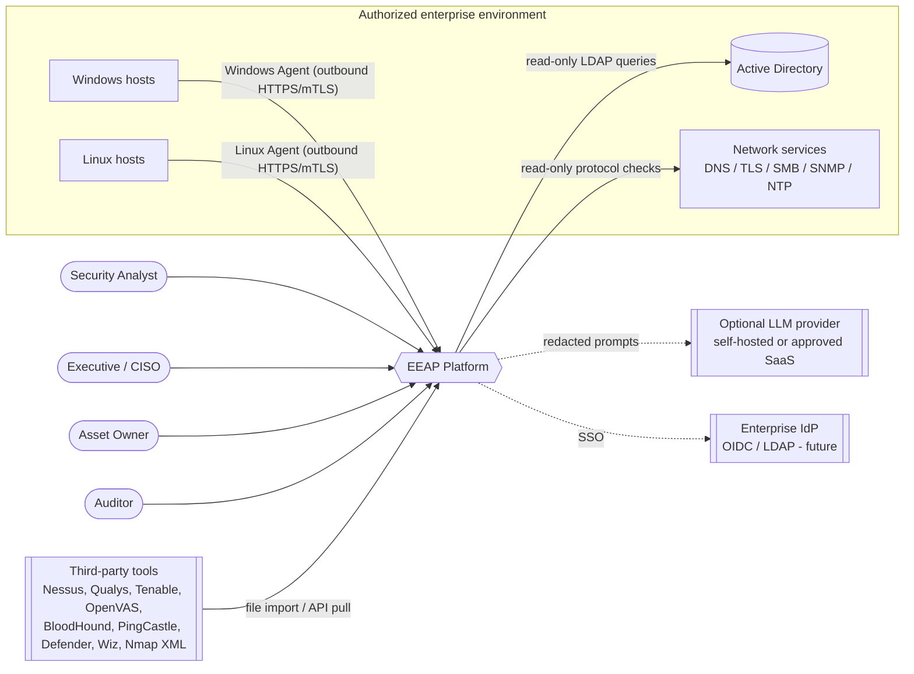
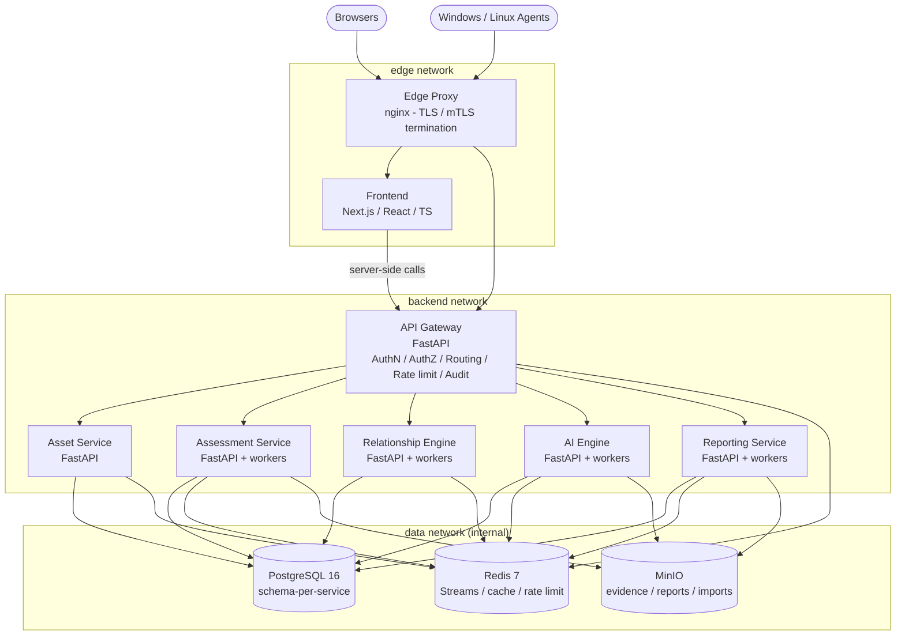
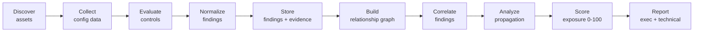

# 01 — System Architecture

## 1. Purpose and scope

EEAP continuously answers four questions for an authorized enterprise environment:

1. **What do we have?** — asset inventory, classification, ownership, criticality.
2. **How is it configured?** — read-only collection of security-relevant configuration.
3. **Where are we exposed?** — baseline evaluation, normalized findings, relationship graphs.
4. **What should we fix first?** — correlation, exposure scoring, prioritized remediation.

Non-goals (enforced architecturally, see ADR-0011): exploit execution, credential
extraction, attack automation, authentication bypass, lateral movement.

## 2. Architectural principles

| # | Principle | Consequence |
|---|-----------|-------------|
| P1 | **Read-only by design** | Collectors only read configuration; agents have no remote-exec channel. |
| P2 | **Single entry point** | All external traffic (users, agents, integrations) traverses the edge proxy and API Gateway. |
| P3 | **Normalize early** | Every source (agent, network collector, third-party import) produces the Standard Finding Format. |
| P4 | **Deterministic core, AI as advisor** | Scores and correlations are reproducible rules; LLM output is advisory and labeled (ADR-0010). |
| P5 | **Service owns its data** | Schema-per-service in PostgreSQL; no cross-schema writes (ADR-0003). |
| P6 | **Events for propagation, REST for queries** | State changes are published to Redis Streams; reads are synchronous REST (ADR-0005). |
| P7 | **Evidence is immutable** | Raw collection output is stored once in MinIO, content-addressed, referenced by findings. |
| P8 | **Explainability** | Every score stores its factor breakdown and model version. |
| P9 | **Docker-native, 12-factor** | Config via env vars, secrets via files, logs to stdout, stateless services. |

## 3. Context view (C4 Level 1)

## 4. Container view (C4 Level 2)

Notes:

- The diagram in the original brief shows PostgreSQL → Redis → MinIO in sequence. They are
  in fact **peer** data stores; each service connects directly to the stores it needs.
- The **Relationship Engine** sits *below* Asset, Assessment and AI services in the
  logical flow: it consumes their events to build the exposure graph, and the AI Engine
  queries it for propagation analysis.

## 5. Logical data flow

| Stage | Owner | Store |
|-------|-------|-------|
| Discover | Asset Service (+ discovery collectors via Assessment) | `asset.*` |
| Collect | Agents, Assessment Service network/AD collectors, integration importers | MinIO `eeap-evidence` |
| Evaluate / Normalize / Store | Assessment Service | `assessment.*` |
| Graph | Relationship Engine | `graph.*` |
| Correlate / Propagate / Score | AI Engine (deterministic engine + optional LLM) | `ai.*` |
| Report | Reporting Service | `reporting.*`, MinIO `eeap-reports` |

## 6. Communication model

| Interaction | Style | Technology |
|-------------|-------|------------|
| Browser → platform | Sync | HTTPS → Edge Proxy → Frontend / Gateway (`/api/v1`) |
| Agent → platform | Sync, agent-initiated (pull) | HTTPS + mTLS → Gateway (`/api/v1/agent`) |
| Gateway → services | Sync | Internal HTTP + short-lived internal service JWT |
| Service → service (queries) | Sync | Internal HTTP via Docker DNS (`http://asset-service:8000`) |
| State change propagation | Async | Redis Streams, consumer groups, at-least-once (ADR-0005) |
| Large payloads | Claim-check | MinIO object + reference in event / row |

Services never call the gateway; the gateway is ingress-only. Inter-service calls are
limited to **read** queries; **writes** to another service's domain happen only through
that service's API or by it consuming an event.

## 7. Quality attributes

| Attribute | Target (Phase 2+ acceptance) | Mechanism |
|-----------|------------------------------|-----------|
| Scale | 50k assets, 5M findings, 2M graph edges per deployment | Indexed PostgreSQL, partitionable `findings`, streaming workers |
| Agent fleet | 10k agents, 15-min heartbeat | Pull model, Redis-cached job lookups |
| API latency | p95 < 300 ms for list endpoints (paginated) | Keyset pagination, read caches |
| Availability | Single-node Compose: restart-on-failure; HA via Swarm/K8s (doc 09) | Stateless services, health checks |
| Recoverability | RPO 24h (Compose), RPO 15 min (HA) | `pg_dump`/WAL archiving, MinIO versioning |
| Auditability | 100% of mutating API calls and auth events audited | Gateway audit middleware, hash-chained log |
| Explainability | Every score reproducible from stored factors | `ai.risk_scores.factors`, `model_version` |
| Security | No secret in env vars or images | Docker secrets, `*_FILE` convention |

## 8. Technology stack

| Layer | Choice | ADR |
|-------|--------|-----|
| Frontend | Next.js 14 (App Router), React 18, TypeScript, TanStack Query, Cytoscape.js (graph view), ECharts | ADR-0002 |
| Backend services | Python 3.12, FastAPI, Pydantic v2, SQLAlchemy 2 (async), Alembic | ADR-0002 |
| Workers | Same images, `worker` entrypoint consuming Redis Streams | ADR-0005 |
| Relational store | PostgreSQL 16 | ADR-0003 |
| Graph | PostgreSQL adjacency tables + recursive CTE, NetworkX in-process analytics | ADR-0004 |
| Event bus / cache | Redis 7 Streams | ADR-0005 |
| Object storage | MinIO (S3 API) | ADR-0006 |
| Reports | Jinja2 → HTML, WeasyPrint → PDF | ADR-0002 |
| Agents | Windows: .NET 8 self-contained service; Linux: Go static binary | ADR-0008 |
| Observability | JSON logs, Prometheus `/metrics`, OpenTelemetry traces | ADR-0012 |
| Edge | nginx (TLS 1.2+/1.3, mTLS for agent paths) | ADR-0007, ADR-0008 |

## 9. Cross-cutting concerns

- **Shared library (`shared/`)**: Pydantic models for Finding/Asset/Relationship/Event,
  JSON-schema contracts, structured logging, settings loader with `*_FILE` secret
  support, Redis Streams producer/consumer helpers, internal-auth middleware, health and
  metrics routers. Packaged as `eeap-shared` and installed into every Python image.
- **Correlation IDs**: `X-Request-ID` generated at the edge, propagated through HTTP
  headers and the event envelope (`correlation_id`), included in every log line.
- **Time**: all timestamps UTC, ISO-8601, `timestamptz` in PostgreSQL.
- **IDs**: UUIDv7 for technical IDs (time-sortable); human-readable business keys for
  assets (`asset_id`, e.g. `SRV001`) and controls (`control_id`, e.g. `AD-001`).
- **Versioning**: REST APIs under `/api/v1`; events carry `type` + `schema_version`;
  control definitions carry `version`; scoring model carries `model_version`.

## 10. Extension points

| Extension | Mechanism | Phase |
|-----------|-----------|-------|
| New control module (AD/WIN/NET/Cloud) | Control plugin registered in Assessment Service catalog (ADR-0009) | 2+ |
| New collector type | Collector plugin interface + agent capability flag | 2+ |
| Third-party import (Nessus, BloodHound, ...) | Integration adapter → Standard Finding / Relationship format (ADR-0014) | 3 |
| LLM provider | `LLMProvider` interface in AI Engine (none / Azure OpenAI / OpenAI / local Ollama) | 2+ |
| Report template | Jinja2 template + registry entry | 2+ |
| Identity provider | OIDC federation at gateway | 3 |
