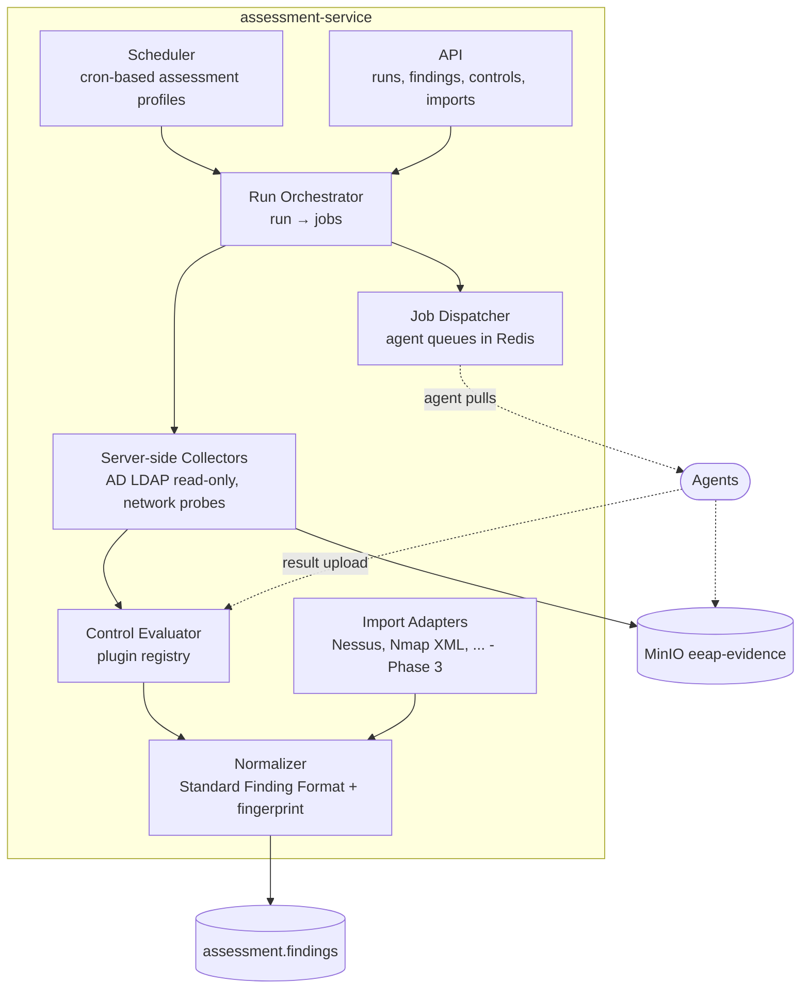
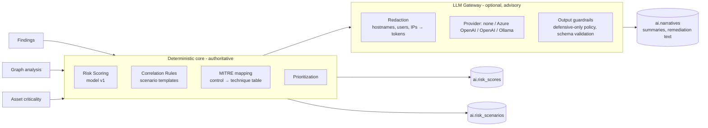

# 02 — Service Design

Every backend service follows the same internal layout and runtime contract so that
operations, security and observability are uniform.

## 1. Common service template

```
services/<name>/
├── Dockerfile                 # multi-stage, non-root, distroless-style runtime
├── pyproject.toml
├── alembic/                   # migrations for this service's schema only
├── app/
│   ├── main.py                # FastAPI app factory (api role)
│   ├── worker.py              # Redis Streams consumer entrypoint (worker role)
│   ├── config.py              # pydantic-settings; *_FILE secret support
│   ├── api/v1/                # routers (thin)
│   ├── domain/                # entities, domain services, pure logic (no I/O)
│   ├── repositories/          # SQLAlchemy data access
│   ├── events/                # producers / consumer handlers
│   └── clients/               # typed HTTP clients to other services
└── tests/
```

Runtime contract (all services):

| Concern | Contract |
|---------|----------|
| Port | `8000` (HTTP) inside the container; never published except gateway/frontend via proxy |
| Liveness | `GET /health/live` → 200 if process responsive |
| Readiness | `GET /health/ready` → 200 only if DB, Redis (and MinIO if used) reachable |
| Metrics | `GET /metrics` Prometheus format (internal network only) |
| Logs | JSON lines on stdout: `ts, level, service, msg, request_id, correlation_id, user_id, trace_id` |
| Auth | Rejects any request without a valid **internal service token** issued by the gateway (except health/metrics) |
| Roles | Same image runs as `api` or `worker` via `EEAP_ROLE` |
| Shutdown | Graceful on SIGTERM: stop accepting, drain in-flight, ack/no-ack stream messages |

## 2. Service catalog

| Service | Schema | MinIO buckets | Publishes | Consumes |
|---------|--------|---------------|-----------|----------|
| api-gateway | `iam`, `audit` | – | `agent.enrolled/revoked/stale`, `audit.event` | – |
| asset-service | `asset` | – | `asset.*` | `discovery.asset_observed` |
| assessment-service | `assessment` | `eeap-evidence`, `eeap-imports` | `assessment.*`, `finding.*`, `discovery.*`, `relationship.observed`, `agent.result_submitted` | `agent.result_submitted`, `assessment.run_requested`, `agent.enrolled/revoked` |
| relationship-engine | `graph` | – | `graph.updated` | `asset.*`, `relationship.observed`, `finding.*` |
| ai-engine | `ai` | `eeap-evidence` (read) | `risk.scores_updated`, `correlation.completed` | `assessment.run_completed`, `graph.updated`, `asset.criticality_changed` |
| reporting-service | `reporting` | `eeap-reports` | `report.generated`, `report.failed` | `report.requested`, `correlation.completed` |

---

## 3. Frontend (Next.js / React / TypeScript)

**Responsibilities**: dashboard, findings explorer, exposure/graph views, risk scores,
reports, administration (users, agents, enrollment tokens, integrations).

| Area | Design |
|------|--------|
| Routing | App Router: `/dashboard`, `/assets`, `/assets/[id]`, `/findings`, `/findings/[id]`, `/exposure/graph`, `/exposure/scenarios`, `/risk`, `/reports`, `/admin/*` |
| Data access | Backend-for-frontend via Next.js route handlers → Gateway; access token kept in an `HttpOnly; Secure; SameSite=Strict` cookie, never in `localStorage` |
| State | TanStack Query (server state), minimal client state |
| Graph view | Cytoscape.js, server-side filtered subgraphs (max 2,000 nodes per view) |
| Charts | ECharts (risk trends, severity distributions, MITRE heatmap) |
| AuthZ in UI | UI hides actions by role, but the Gateway is the enforcement point |
| Security headers | CSP (nonce-based), HSTS (at proxy), `X-Frame-Options: DENY`, `Referrer-Policy` |
| Health | `GET /api/health` |

## 4. API Gateway (FastAPI)

**Responsibilities**: authentication, authorization (RBAC), routing, API management,
rate limiting, audit logging, agent enrollment and identity.

```mermaid
flowchart LR
    req[Request] --> rid[Request-ID] --> rl[Rate limiter<br/>Redis token bucket] --> authn[AuthN<br/>user JWT / agent mTLS+JWT / API key]
    authn --> authz[AuthZ<br/>RBAC permission check] --> val[Schema validation<br/>size limits] --> route[Route table]
    route --> mint[Mint internal service token<br/>sub, roles, scope, 60s TTL] --> svc[Upstream service]
    svc --> audit[Audit middleware<br/>mutations + auth events] --> resp[Response]
```



| Component | Design |
|-----------|--------|
| User auth | Local accounts (Argon2id) in Phase 2; OIDC federation Phase 3. Access JWT RS256 15 min, refresh token 8 h, rotated, stored hashed, revocable |
| Agent auth | mTLS client certificate (issued at enrollment by the internal Agent CA) **and** short-lived agent JWT bound to cert thumbprint (`cnf.x5t#S256`) |
| Integration auth | Scoped API keys (hashed, prefix-identifiable, expiring) |
| RBAC | Permission strings `resource:action`; roles map to permission sets (see doc 07) |
| Routing | Static route table `/api/v1/{assets,assessments,findings,controls,graph,risk,correlations,reports,...}` → upstream base URLs from env |
| Rate limits | Per principal + per IP; separate buckets for `auth/login` (brute-force protection) and agent endpoints |
| Audit | Writes `audit.audit_log` (hash-chained) and publishes `audit.event` |
| Owns | `iam.users`, `iam.roles`, `iam.permissions`, `iam.refresh_tokens`, `iam.api_keys`, `iam.agents`, `iam.agent_enrollment_tokens`, `audit.audit_log` |
| Scaling | Stateless; horizontal behind proxy |

## 5. Asset Service

**Responsibilities**: inventory management, classification, ownership, criticality,
environment tracking, identity reconciliation.

| Component | Design |
|-----------|--------|
| Model | `asset_id` (business key, e.g. `SRV001`), hostname, FQDN, asset_type, criticality, owner team, environment, OS, tier (Tier0/1/2), tags, identifiers (IP, MAC, AD objectSID, DN, cloud resource ID) |
| Reconciliation | `discovery.asset_observed` events are matched by identifier precedence: objectSID → cloud ID → FQDN → hostname+domain → IP (with time window). Match → update `last_seen`; no match → create asset `status=discovered` pending classification |
| Classification | Rule-based auto-classification (e.g. DC → `Tier0`, `criticality=Critical`) with manual override flag that rules never overwrite |
| Criticality | `Critical / High / Medium / Low`; changes publish `asset.criticality_changed` (triggers re-scoring) |
| Ownership | `owners` table (team, contact, escalation); asset ↔ owner many-to-one |
| Publishes | `asset.created`, `asset.updated`, `asset.criticality_changed`, `asset.retired` |

## 6. Assessment Service

**Responsibilities**: execute security checks, run collectors, dispatch agent jobs,
evaluate controls, normalize and store findings, import third-party results.



| Component | Design |
|-----------|--------|
| Control catalog | `assessment.controls` — `control_id`, name, category, module (`AD`, `WIN`, `NET`, `LINUX`, `CLOUD`), default severity, exploitability, privilege impact, MITRE techniques, recommendation template, version, enabled |
| Plugin interface | `Collector.collect(target, params) -> RawEvidence` (read-only) and `Control.evaluate(evidence, context) -> list[FindingDraft]` (pure function). See ADR-0009 |
| Execution sites | `server` (AD over LDAPS, network probes from the assessment container), `agent:windows`, `agent:linux`, `import` |
| Runs and jobs | `assessment_runs` (scope, profile, status) → `assessment_jobs` (one per target × collector), job states `pending → dispatched → running → succeeded / failed / expired` |
| Idempotency | Finding fingerprint = `sha256(asset_id, control_id, normalized subject key)`; upsert updates `last_seen_at`; findings not re-observed in a completed run with full scope → `lifecycle_state=resolved` |
| Evidence | Raw collector output stored in MinIO `eeap-evidence/<run_id>/<job_id>/<sha256>.json`; findings carry `evidence` (summarized) and `raw_data_ref` |
| Relationships | Collectors emitting relationship facts (group membership, delegation, local admin) publish `relationship.observed` for the Relationship Engine |
| Publishes | `assessment.run_started`, `assessment.run_completed`, `finding.created`, `finding.updated`, `finding.resolved`, `discovery.asset_observed`, `relationship.observed` |
| Scaling | API stateless; workers scale horizontally per consumer group |

## 7. Relationship Engine

**Responsibilities**: build security relationships and exposure graphs, discover risk
concentration areas, support correlation and propagation analysis.

| Component | Design |
|-----------|--------|
| Node types | `User`, `Computer`, `Group`, `ServiceAccount`, `Tier0Asset` (label, combinable via `is_tier0`) |
| Edge types | `MemberOf`, `AdministrativeAccess`, `Delegation`, `AuthenticationRisk`, `RemoteAccess`, `PrivilegedAccess` |
| Storage | `graph.nodes` / `graph.edges` adjacency tables, versioned by `observed_run_id`, `first_seen_at`, `last_seen_at` (ADR-0004) |
| Ingestion | Consumes `relationship.observed` (upsert edges), `asset.*` (sync Computer/Tier0 nodes), `finding.*` (annotate nodes with finding counts / `AuthenticationRisk` edges) |
| Analytics | Snapshot loaded into NetworkX per analysis job: reachability to Tier0 (bounded BFS, max depth 6), in-degree concentration on privileged groups, betweenness centrality (sampled), transitive group expansion |
| Outputs | `graph.analysis_results` (per-node `tier0_reachable`, `paths_to_tier0`, `concentration_score`, `propagation_score` 0–1) |
| API | Node/edge queries, neighborhood subgraph, path query (bounded), concentration areas |
| Publishes | `graph.updated` (after ingest batch), `graph.analysis_completed` |

The graph is used for **exposure analysis only** (which privileged relationships widen
blast radius); it does not generate or execute attack steps.

## 8. AI Engine

**Responsibilities**: finding summarization, correlation, risk propagation analysis,
MITRE ATT&CK mapping, exposure analysis, remediation guidance, risk scoring.



| Component | Design |
|-----------|--------|
| Scoring | Deterministic, versioned formula (doc 08). Recomputed on `assessment.run_completed`, `graph.analysis_completed`, `asset.criticality_changed` |
| Correlation | Declarative rule set (YAML): conditions over findings + graph facts → `RiskScenario` with ordered stages, e.g. *Authentication Hardening Gap → Service Account Risk → Privileged Resource Exposure → Increased Organizational Risk* |
| MITRE mapping | Static mapping table `ai.mitre_mappings` (control → technique IDs) seeded from control catalog; used for coverage heatmaps (defensive context: *which techniques a weakness may enable*) |
| Remediation | Template recommendation from control + optional LLM elaboration; roadmap ordering by risk reduction per effort |
| LLM usage | Disabled by default (`AI_LLM_PROVIDER=none`). When enabled: redacted inputs, no raw evidence, output labeled `generated_by=llm`, never alters scores |
| Publishes | `risk.scores_updated`, `correlation.completed` |

## 9. Reporting Service

**Responsibilities**: executive summary, technical report, security posture report,
MITRE ATT&CK mapping, risk dashboard data, remediation roadmap.

| Component | Design |
|-----------|--------|
| Request flow | `POST /reports` → `reporting.reports` row `queued` → `report.requested` → worker renders → MinIO `eeap-reports/<report_id>.<fmt>` → `completed` |
| Formats | JSON (canonical data model), HTML (Jinja2), PDF (WeasyPrint from HTML) |
| Data assembly | Pulls from Asset, Assessment, Relationship and AI services via internal APIs as of a **snapshot timestamp** so reports are reproducible |
| Templates | `executive_summary`, `technical`, `security_posture`, `mitre_mapping`, `risk_dashboard`, `remediation_roadmap` (versioned) |
| Delivery | Pre-signed MinIO URLs (5-min TTL) proxied through the gateway download endpoint so access is authorized and audited |
| Integrity | SHA-256 of each artifact stored in `reporting.reports.sha256` |

## 10. Agents

| Aspect | Windows Agent | Linux Agent |
|--------|---------------|-------------|
| Runtime | .NET 8 Windows Service, self-contained, signed | Go static binary, systemd unit |
| Privilege | Runs as a dedicated low-privilege service account with read access to the required registry keys / WMI classes | Runs as `eeap-agent` user; root-required reads use a narrowly scoped, read-only sudoers allow-list |
| Collectors (Phase 2+) | Registry checks, local administrators, security product discovery, SMB / WinRM / RDP configuration | SSH config, sudo rights review, service enumeration, baseline validation |
| Communication | Outbound-only HTTPS + mTLS to edge proxy; **pull** jobs, **push** results | Same |
| Job model | Jobs reference a **collector ID from a signed, built-in allow-list**; the platform cannot send arbitrary commands or scripts | Same |
| Offline | Local encrypted spool (max 7 days), resumes upload | Same |
| Update | Signed packages distributed via enterprise tooling (SCCM/Intune, apt/yum repo) | Same |

## 11. Service dependency matrix

| From \ To | gateway | asset | assessment | relationship | ai | reporting | postgres | redis | minio |
|-----------|:-:|:-:|:-:|:-:|:-:|:-:|:-:|:-:|:-:|
| frontend | ● | | | | | | | | |
| gateway | | ● | ● | ● | ● | ● | ● | ● | |
| asset | | | | | | | ● | ● | |
| assessment | | ○ | | | | | ● | ● | ● |
| relationship | | ○ | | | | | ● | ● | |
| ai | | ○ | ○ | ○ | | | ● | ● | ● |
| reporting | | ○ | ○ | ○ | ○ | | ● | ● | ● |

● required at startup (readiness) · ○ read-only runtime query (degrades gracefully)
