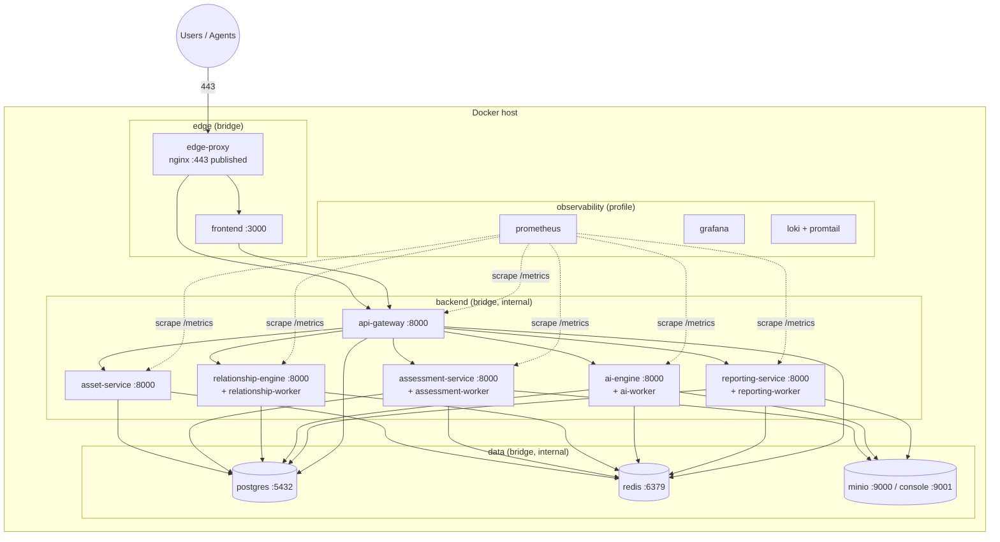

# 03 — Docker Architecture

## 1. Topology



## 2. Networks

| Network | Driver | `internal` | Members | Purpose |
|---------|--------|-----------|---------|---------|
| `eeap-edge` | bridge | no | edge-proxy, frontend, api-gateway | Ingress only; only `edge-proxy` publishes a host port |
| `eeap-backend` | bridge | yes | frontend, api-gateway, all services and workers, prometheus | Service-to-service HTTP |
| `eeap-data` | bridge | yes | api-gateway, services, workers, postgres, redis, minio, minio-init | Data stores; unreachable from edge |
| `eeap-observability` | bridge | yes | prometheus, grafana, loki, promtail | Telemetry |
| `eeap-scan` | bridge (macvlan in prod) | no | assessment-service, assessment-worker | Egress to the assessed environment |
| `eeap-llm` | bridge | no | ai-engine, ai-worker | Egress to an external LLM provider (unused when `AI_LLM_PROVIDER=none`) |
| `eeap-grafana` | bridge | no | grafana | Publishes Grafana on `127.0.0.1` only |

`internal: true` networks have no outbound route and Docker does not publish ports for
containers attached only to them. The **assessment-service / assessment-worker** join
`eeap-scan` because server-side collectors must reach AD and network targets; this is
the only egress path into the enterprise network and is firewall-scoped per deployment
(doc 09). The data tier is reached for administration with `docker compose exec`.

## 3. Service discovery

- Docker embedded DNS: each service is reachable by its Compose service name on shared
  networks, e.g. `http://asset-service:8000`, `postgres:5432`, `redis:6379`, `minio:9000`.
- Upstream URLs are injected via env vars (`ASSET_SERVICE_URL`, ...) so the same images
  run unchanged on Swarm/Kubernetes, where DNS names map to Services.
- Scaled replicas (`docker compose up --scale assessment-worker=4`) are load-balanced by
  Docker DNS round-robin; workers coordinate via Redis Stream consumer groups.

## 4. Image standards

| Rule | Implementation |
|------|----------------|
| Multi-stage builds | `builder` (deps + wheels) → `runtime` (python:3.12-slim / node:20-alpine) |
| Non-root | `USER 10001:10001`; read-only root filesystem; `tmpfs: /tmp` |
| Minimal capabilities | `cap_drop: [ALL]`, `security_opt: [no-new-privileges:true]` |
| Pinned bases | Base images pinned by digest in Phase 2 CI |
| Shared lib | `shared/` built once as wheel, copied into each Python image |
| Labels | OCI labels: `org.opencontainers.image.{source,version,revision}` |
| Scanning | Trivy scan + SBOM (Syft) in CI; build fails on Critical CVEs |
| Health | `HEALTHCHECK` in Dockerfile *and* `healthcheck:` in Compose |

Reference Python Dockerfile (to be instantiated per service in Phase 2):

```dockerfile
# syntax=docker/dockerfile:1.7
FROM python:3.12-slim AS builder
WORKDIR /build
COPY shared/ /build/shared/
COPY services/asset-service/pyproject.toml /build/svc/
RUN pip wheel --wheel-dir /wheels /build/shared /build/svc

FROM python:3.12-slim AS runtime
RUN useradd --uid 10001 --create-home eeap
COPY --from=builder /wheels /wheels
RUN pip install --no-cache-dir /wheels/* && rm -rf /wheels
COPY services/asset-service/app /app/app
WORKDIR /app
USER 10001
ENV EEAP_ROLE=api PYTHONUNBUFFERED=1
EXPOSE 8000
HEALTHCHECK --interval=15s --timeout=3s --retries=5 \
  CMD python -c "import urllib.request,sys; sys.exit(0 if urllib.request.urlopen('http://127.0.0.1:8000/health/live').status==200 else 1)"
ENTRYPOINT ["python", "-m", "app.entrypoint"]   # dispatches on EEAP_ROLE: api | worker | migrate
```

## 5. Health checks

| Container | Check | Interval / retries | `depends_on` condition |
|-----------|-------|--------------------|------------------------|
| postgres | `pg_isready -U $USER -d eeap` | 10s / 10 | `service_healthy` |
| redis | `redis-cli -a <secret> ping` | 10s / 10 | `service_healthy` |
| minio | `mc ready local` | 10s / 10 | `service_healthy` |
| minio-init | one-shot bucket/policy creation | – | `service_completed_successfully` |
| *-migrate | one-shot `alembic upgrade head` per service | – | `service_completed_successfully` |
| services | `GET /health/live` (Docker); `/health/ready` used by proxy/orchestrator | 15s / 5 | `service_healthy` |
| workers | heartbeat file `/tmp/worker.heartbeat` updated every 10s, checked for staleness < 30s | 15s / 5 | – |
| frontend | `GET /api/health` | 15s / 5 | `service_healthy` |
| edge-proxy | `nginx -t` + `GET /healthz` | 30s / 3 | – |

Startup ordering: `postgres, redis, minio` → `minio-init`, `*-migrate` → services →
workers → `frontend` → `edge-proxy`.

## 6. Volumes

| Volume | Mounted by | Content | Backup |
|--------|-----------|---------|--------|
| `pg_data` | postgres | Database files | `pg_dump` nightly / WAL archive to MinIO `eeap-backups` |
| `redis_data` | redis | AOF (`appendonly yes`) for stream durability | Optional snapshot |
| `minio_data` | minio | Evidence, reports, imports, backups | Bucket versioning + replication (HA) |
| `prometheus_data`, `grafana_data`, `loki_data` | observability | Telemetry | Not required |

Bind mounts are limited to read-only configuration (`./infrastructure/...:ro`).

## 7. Configuration and secrets

**Environment variables** carry non-secret configuration (see `.env.example`):
log level, upstream URLs, feature flags, rate limits, token TTLs.

**Secrets** are Docker secrets mounted at `/run/secrets/<name>` and referenced through the
`<VAR>_FILE` convention; the shared settings loader reads `X_FILE` when `X` is unset.

| Secret | Consumers |
|--------|-----------|
| `postgres_superuser_password` | postgres (bootstrap only) |
| `db_password_<service>` | each service (own DB role, own schema) |
| `redis_password` | gateway, services, workers |
| `minio_root_user`, `minio_root_password` | minio, minio-init (bootstrap only) |
| `minio_secret_{assessment,ai,reporting,backup}` | per-service MinIO users `svc-*`, each limited by a bucket policy (`infrastructure/minio/policies/`) |
| `jwt_signing_key` (RS256 private), `jwt_public_key` | gateway (sign), services (verify) |
| `internal_token_private_key` (Ed25519), `internal_token_public_key` | gateway (sign internal tokens), services (verify only — a compromised service cannot mint tokens) |
| `agent_ca_key`, `agent_ca_cert` | gateway (issue agent certs), edge-proxy (verify, cert only) |
| `tls_cert`, `tls_key` | edge-proxy |
| `llm_api_key` (optional) | ai-engine |
| `grafana_admin_password` | grafana (observability profile) |

Secrets are created by `scripts/generate-secrets.sh` for non-production use. Production
deployments source them from an enterprise secret store (Vault / Azure Key Vault /
AWS Secrets Manager) — see ADR-0013.

Compose (non-Swarm) bind-mounts file secrets with their host permissions, so the
generator makes files `0644` inside a `0700` `secrets/` directory: the host directory
protects them, and non-root containers can still read them.

## 8. Logging and metrics

- All containers log JSON to stdout; Docker `json-file` driver with rotation
  (`max-size: 20m`, `max-file: 5`). Promtail (observability profile) ships to Loki.
- Each service exposes `/metrics` on the backend network (API role on `:8000`, worker role
  on `:9100`); Prometheus discovers replicas through Docker DNS. The edge proxy **blocks**
  `/metrics` and `/health/ready` externally.
- Standard metrics: `http_requests_total`, `http_request_duration_seconds`,
  `eeap_events_published_total`, `eeap_events_consumed_total`, `eeap_event_lag`,
  `eeap_findings_total{severity,status}`, `eeap_agents_connected`,
  `eeap_assessment_jobs{state}`, `eeap_report_render_seconds`.

## 9. Compose profiles

| Profile | Containers | Use |
|---------|-----------|-----|
| *(default)* | postgres, redis, minio, minio-init | Phase 1 validation; data tier |
| `app` | edge-proxy, frontend, api-gateway, 5 services, 4 workers, migrations | Full platform (Phase 2+) |
| `observability` | prometheus, grafana, loki, promtail | Monitoring |

`docker compose --profile app up -d` is the single-command full deployment.
