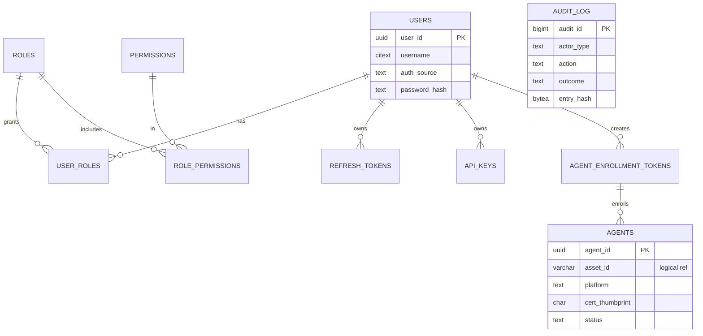
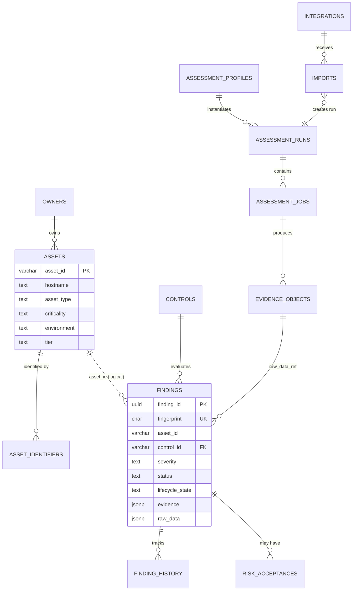
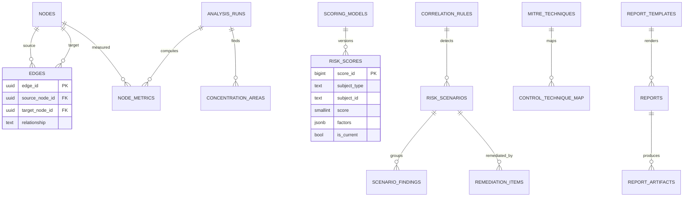
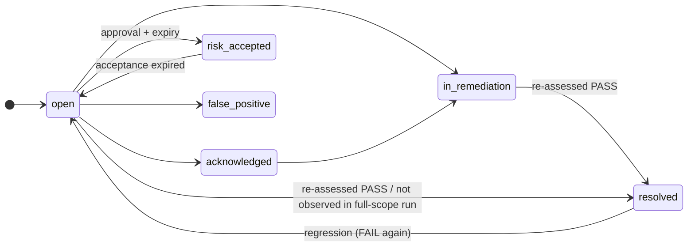

# 04 — Database Design

Authoritative DDL: [`infrastructure/postgres/init/`](../../infrastructure/postgres/init/).
Executed in lexical order by the PostgreSQL container on first start; from Phase 2 each
service evolves its own schema via Alembic, using this DDL as revision `0001_baseline`.

## 1. Strategy

| Decision | Choice | Rationale |
|----------|--------|-----------|
| Engine | PostgreSQL 16 | JSONB, recursive CTEs, partial indexes, row-level security, mature ops (ADR-0003) |
| Isolation | One database `eeap`, **one schema + one login role per service** | Data ownership without operating six clusters; can split to separate DBs later without code changes |
| Cross-service references | Logical IDs only (no cross-schema FKs) | Services deploy and migrate independently |
| Enumerations | `text` + `CHECK` constraints | Easier to evolve than PG `ENUM` types in migrations |
| Keys | UUID for technical IDs; business keys for `asset_id` and `control_id` | Matches the Standard Finding Format and human-readable asset IDs |
| Timestamps | `timestamptz`, UTC, `created_at` / `updated_at` (trigger-maintained) | Consistency |
| Large data | MinIO objects referenced by `bucket` + `object_key` + `sha256` | Keeps rows small, evidence immutable |
| Reliable events | Transactional **outbox** + idempotent **inbox** per schema | Exactly-once *effect* over an at-least-once bus |

## 2. Schema map

| Schema | Owner role | Service | Tables |
|--------|-----------|---------|--------|
| `iam` | `eeap_gateway` | API Gateway | users, roles, permissions, role_permissions, user_roles, refresh_tokens, api_keys, agent_enrollment_tokens, agents |
| `audit` | `eeap_audit_owner` (NOLOGIN) | API Gateway (INSERT/SELECT only) | audit_log |
| `asset` | `eeap_asset` | Asset Service | owners, assets, asset_identifiers, classification_rules |
| `assessment` | `eeap_assessment` | Assessment Service | controls, assessment_profiles, assessment_runs, assessment_jobs, evidence_objects, findings, finding_history, risk_acceptances, integrations, imports |
| `graph` | `eeap_relationship` | Relationship Engine | nodes, edges, analysis_runs, node_metrics, concentration_areas |
| `ai` | `eeap_ai` | AI Engine | scoring_models, risk_scores, correlation_rules, risk_scenarios, scenario_findings, mitre_techniques, control_technique_map, remediation_items, narratives |
| `reporting` | `eeap_reporting` | Reporting Service | report_templates, reports, report_artifacts, report_schedules |
| *each above* | service role | all | event_outbox, event_inbox |

## 3. Entity-relationship diagrams

### 3.1 Identity, access and agents (`iam`, `audit`)



### 3.2 Assets and findings (`asset`, `assessment`)



### 3.3 Graph, risk and reporting (`graph`, `ai`, `reporting`)



## 4. Key table semantics

### 4.1 `assessment.findings` — Standard Finding Format

| Standard field | Column | Notes |
|----------------|--------|-------|
| `finding_id` | `finding_id uuid` | Stable across re-observations |
| `asset_id` | `asset_id varchar(64)` | Logical ref to `asset.assets` |
| `control_id` / `control_name` / `category` | same | Denormalized from catalog at evaluation time (historical accuracy) |
| `severity` | `severity` | `Critical, High, Medium, Low, Informational` |
| `status` | `status` | `PASS, FAIL, WARNING, INFO` — *evaluation result* |
| `evidence` | `evidence jsonb` | Summarized evidence safe for UI and reports |
| `recommendation` | `recommendation` | Rendered from control template |
| `raw_data` | `raw_data jsonb` (≤ 64 KiB) + `raw_data_ref` → MinIO | Large raw payloads only in MinIO |
| `created_at` | `created_at` | |

Additional columns: `fingerprint` (dedupe), `lifecycle_state` (*workflow* state,
independent of `status`), `subject_key`, `source`, `source_tool`, `first_seen_*`,
`last_seen_*`, `resolved_at`.

Two orthogonal state dimensions:



### 4.2 Fingerprint and deduplication

```
fingerprint = sha256( asset_id | control_id | subject_key )
```

`subject_key` distinguishes multiple findings of one control on one asset (e.g., each
dormant privileged account in AD-007). Re-evaluation upserts on `fingerprint`, writes
`finding_history` when `status`, `severity` or `lifecycle_state` changes.

### 4.3 `graph.nodes` / `graph.edges`

- `node_key` is the natural key used for idempotent upserts:
  `ad:<objectSID>`, `asset:<asset_id>`, `local:<asset_id>:<SID>`.
- `Tier0Asset` is a node type for Tier-0 objects that are not computers (e.g., the domain
  object, a PKI CA object). Computers that are Tier 0 keep `node_type='Computer'` and
  set `is_tier0=true`, so queries use `is_tier0` rather than the type.
- Edges are unique per `(source, target, relationship)`; disappearance is soft
  (`is_active=false`) to preserve history for trend analysis.

### 4.4 `ai.risk_scores`

Append-only score history; exactly one `is_current=true` row per subject (partial
unique index). `factors` stores the full input vector and weights so any score can be
re-derived (doc 08). A `CHECK` constraint enforces the rating bands.

### 4.5 `audit.audit_log`

Append-only enforced three ways: owned by a NOLOGIN role, gateway has only
`INSERT, SELECT`, and triggers reject `UPDATE / DELETE / TRUNCATE`. `entry_hash` chains
each row to its predecessor for tamper evidence; a nightly job verifies the chain.

## 5. Indexing and query patterns

| Query | Index |
|-------|-------|
| Findings triage list (status, severity, lifecycle, recency) | `findings_triage_idx` |
| Findings by asset / by control | `findings_asset_idx`, `findings_control_idx` |
| JSON evidence search | GIN `jsonb_path_ops` on `evidence` |
| Asset search by hostname fragment | GIN trigram on `hostname` |
| Discovery reconciliation | `asset_identifiers_lookup_idx` (+ unique for stable IDs) |
| Graph traversal (out / in) | Partial `edges_out_idx`, `edges_in_idx` on active edges |
| Current score ranking | Partial `risk_scores_rank_idx` |
| Outbox relay | Partial `event_outbox_unpublished_idx` |

All list APIs use **keyset pagination** on `(sort_key, id)`.

## 6. Scale and lifecycle

| Concern | Approach |
|---------|----------|
| `finding_history`, `audit_log`, `risk_scores` growth | Monthly range partitioning on time column once > 50M rows (Phase 3; DDL is partition-compatible) |
| Evidence retention | `evidence_objects.retention_until` + MinIO lifecycle rule (default 365 days) |
| Report retention | `reports.expires_at` + MinIO lifecycle (default 180 days) |
| Inbox cleanup | Rows older than stream retention (7 days) purged daily |
| Connection management | Per-service pool (async SQLAlchemy, max 10); PgBouncer in HA deployments |
| Backups | Nightly `pg_dump -Fc` to MinIO `eeap-backups`; WAL archiving in HA (doc 09) |

## 7. Security controls in the database

- Separate login roles per service, no superuser use at runtime; `public` schema
  `CREATE` revoked; database `CONNECT` granted explicitly.
- Secrets are never stored: passwords as Argon2id, tokens/API keys as SHA-256, integration
  credentials only as `secret_ref` into the secret store.
- TLS between services and PostgreSQL in production (`sslmode=verify-full`).
- Row-level security on `asset` and `assessment` for `asset_owner` scoping is enforced in the
  service layer in Phase 2, with PostgreSQL RLS policies planned for Phase 3.

## 8. Seed and sample data

`09_seed_reference_data.sql` provides reference data only: RBAC roles/permissions,
classification rules, the control catalog **metadata** (all controls disabled; no
evaluation logic in Phase 1), scoring model `v1`, reference correlation rule
`CORR-AUTH-001`, and report templates.
