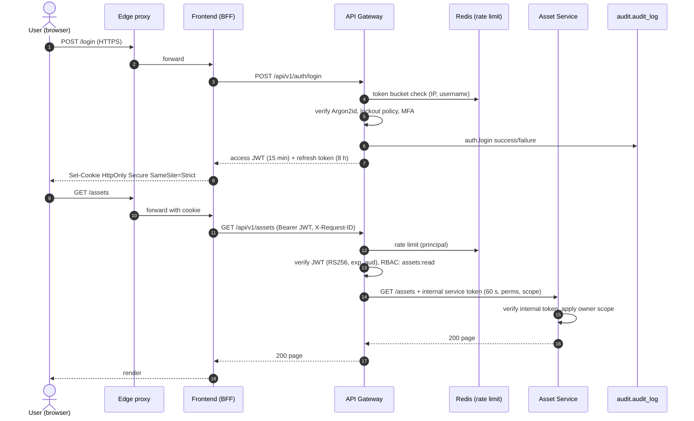
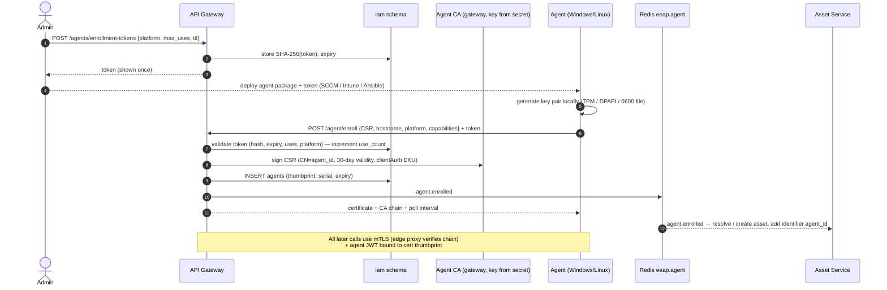
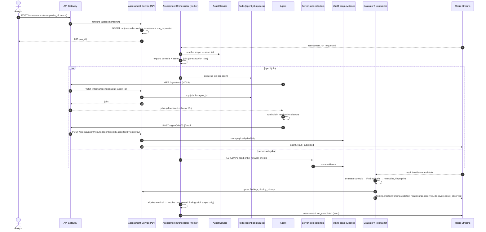
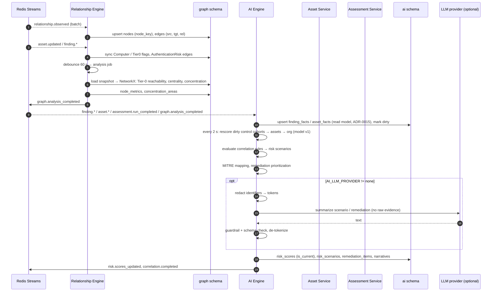
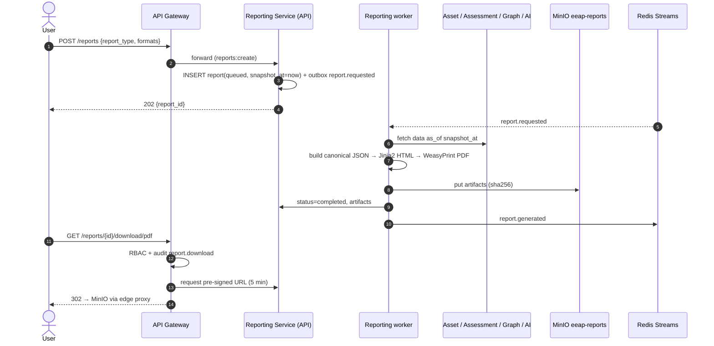
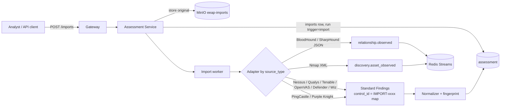
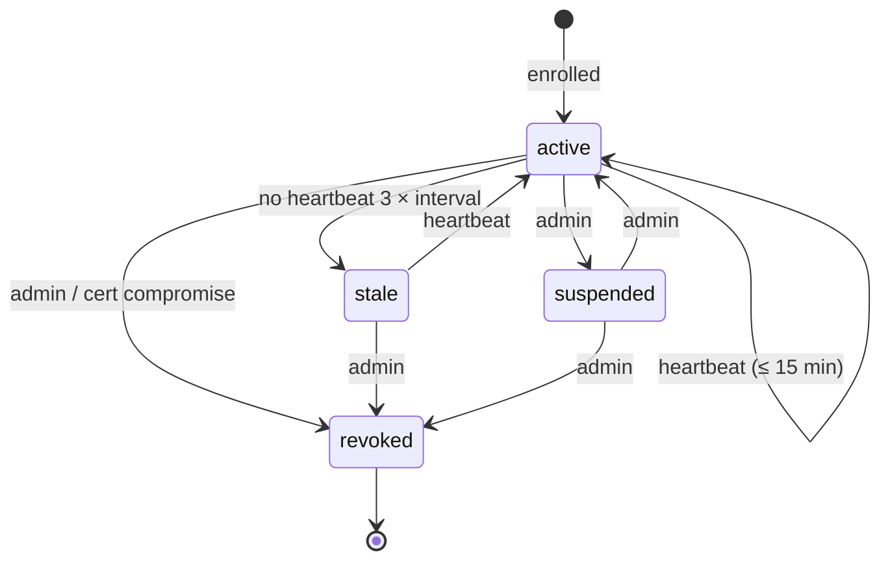

# 06 — Event Flow Diagrams

All flows below use the reliable-publish pattern: a service writes its state change and
an `event_outbox` row in **one transaction**; the outbox relay publishes to Redis Streams;
consumers record `event_id` in `event_inbox` in the same transaction as their side
effects.

## 1. Reliable event publication (pattern)

```mermaid
sequenceDiagram
    autonumber
    participant S as Producer service
    participant DB as PostgreSQL (service schema)
    participant R as Outbox relay
    participant X as Redis Stream
    participant C as Consumer worker
    participant CDB as PostgreSQL (consumer schema)

    S->>DB: BEGIN; write domain rows; INSERT event_outbox; COMMIT
    loop every 500 ms / LISTEN-NOTIFY
        R->>DB: SELECT unpublished FOR UPDATE SKIP LOCKED
        R->>X: XADD eeap.<domain> envelope
        R->>DB: UPDATE published_at
    end
    C->>X: XREADGROUP (group, consumer)
    C->>CDB: BEGIN; INSERT event_inbox (dedupe); apply side effects; COMMIT
    C->>X: XACK
    Note over C,X: Pending messages idle > 60 s are reclaimed via XAUTOCLAIM.<br/>After 5 failed deliveries → eeap.dlq
```

## 2. User authentication and authorized request



## 3. Agent enrollment



## 4. Assessment run (end-to-end)



## 5. Graph build, correlation and scoring



## 6. Report generation



## 7. Third-party import (Phase 3)



## 8. Agent heartbeat and staleness


