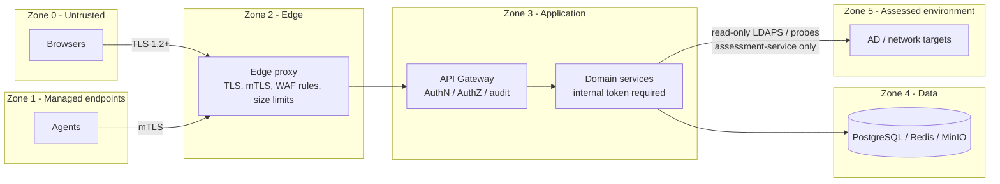

# 07 — Security Architecture

EEAP holds a detailed map of an organization's weaknesses, so the platform itself is a
high-value target. It is designed as a Tier-0-adjacent system.

## 1. Trust boundaries

| Boundary | Controls |
|----------|----------|
| Z0/Z1 → Z2 | TLS 1.2+ (1.3 preferred), HSTS, mTLS required on `/api/v1/agent/*` except `/agent/enroll`, request size limits, header normalization |
| Z2 → Z3 | Only gateway and frontend reachable; `/metrics`, `/health/ready`, `/internal/*` blocked |
| Z3 internal | Internal service JWT (60 s, audience-bound) on every call; services reject direct calls without it |
| Z3 → Z4 | Per-service DB roles, scoped MinIO access keys and bucket policies, Redis ACL users (Phase 2) |
| Z3 → Z5 | Only assessment containers; dedicated read-only directory service account; egress firewall allow-list |

## 2. Authentication

| Principal | Mechanism | Lifetime | Storage |
|-----------|-----------|----------|---------|
| Human user | Username + password (Argon2id, m=64 MiB, t=3) + optional TOTP; OIDC (Phase 3) | Access 15 min, refresh 8 h, rotating | Refresh token hash only; rotation reuse detection revokes the family |
| Agent | mTLS client cert (Agent CA) + agent JWT with `cnf.x5t#S256` | Cert 30 d (auto-renew at 2/3), JWT 15 min | Private key never leaves host |
| Integration client | API key `eeap_<prefix>_<secret>` | ≤ 365 d, must expire | SHA-256 hash |
| Service | Internal JWT signed by gateway (`internal_token_key`) or service client credentials for background jobs | 60 s | – |

JWT details: RS256 (keys from Docker secrets), `kid` header for rotation, JWKS endpoint,
claims `iss, aud, sub, exp, iat, jti, roles, perms`. Signing keys rotate every 90 days
with a 2-key overlap.

## 3. Authorization (RBAC)

Permission strings `resource:action` (seeded in `iam.permissions`). Roles:

| Permission | admin | security_analyst | auditor | executive | asset_owner* | integration_client | agent |
|------------|:-:|:-:|:-:|:-:|:-:|:-:|:-:|
| assets:read | ✓ | ✓ | ✓ | ✓ | ✓ | ✓ | |
| assets:write | ✓ | ✓ | | | | | |
| assets:delete | ✓ | | | | | | |
| findings:read | ✓ | ✓ | ✓ | | ✓ | ✓ | |
| findings:triage | ✓ | ✓ | | | ✓ | | |
| findings:accept_risk | ✓ | | | | | | |
| evidence:read | ✓ | ✓ | ✓ | | | | |
| assessments:read / run / manage | ✓ | ✓ | read | | | | |
| controls:read / manage | ✓ | read | read | | | | |
| graph:read | ✓ | ✓ | ✓ | | | | |
| risk:read / manage | ✓ | ✓ | read | read | read | read | |
| reports:read / create | ✓ | ✓ | read | ✓ | read | | |
| agents:read / manage | ✓ | read | read | | | | |
| integrations:manage | ✓ | | | | | | |
| imports:create | ✓ | ✓ | | | | ✓ | |
| users:read / manage | ✓ | | read | | | | |
| audit:read | ✓ | | ✓ | | | | |
| agent:self | | | | | | | ✓ |

\* `asset_owner` is scoped by `user_roles.scope.owner_ids`; enforced in services.

Separation of duties: `findings:accept_risk` is admin-only by default and can be granted
to a dedicated risk-approver role; the requester of a risk acceptance cannot approve it.

## 4. Secure agent registration

1. Admin creates an enrollment token (hashed at rest, TTL ≤ 7 days, max uses, platform-bound).
2. Agent generates its key pair locally (Windows: CNG/TPM-backed where available; Linux:
   `0600` file owned by `eeap-agent`).
3. Agent sends CSR + token over server-authenticated TLS (agent pins the platform CA
   fingerprint provided in the install package).
4. Gateway validates token, signs CSR (`CN=<agent_id>`, EKU clientAuth, 30-day validity),
   records thumbprint; token use is audited.
5. All further calls require mTLS; the gateway checks the presented cert thumbprint
   against `iam.agents` and `status=active` (revocation is immediate, no CRL dependency).
6. **Capability containment**: agents execute only collectors compiled into the signed
   binary; job payloads contain a collector ID and declarative params, never code.
   Agents never receive credentials from the platform.

## 5. Audit logging

- Gateway middleware records: all authentication events, all mutating requests, access to
  evidence and report downloads, permission denials, agent enrollment/revocation, admin
  actions. Fields: actor, action, resource, outcome, IP, user agent, request ID.
- Append-only + hash chain (doc 04 §4.5); daily chain verification job; optional
  forwarding to SIEM via `eeap.audit` stream (syslog/CEF forwarder, Phase 3).
- No secrets, tokens, passwords or raw evidence are written to audit or application logs
  (log redaction filter in `shared/logging`).

## 6. Rate limiting

Redis-backed token bucket (atomic Lua script) at the gateway:

| Bucket | Default |
|--------|---------|
| `auth/login` per IP | 10 / min |
| `auth/login` per username | 5 / min, then progressive lockout (5 failures → 15 min) |
| Authenticated user | 600 / min |
| API key | 1,200 / min (configurable per key) |
| Agent | 60 / min |
| `agent/enroll` per IP | 5 / min |
| Report creation per user | 20 / hour |

Edge proxy adds a coarse per-IP connection/request limit as the first layer.

## 7. Secrets management

| Stage | Mechanism |
|-------|-----------|
| Development / PoC | `scripts/generate-secrets.sh` → `./secrets/*` (git-ignored, `0600`) → Docker secrets |
| Production (Compose / Swarm) | Swarm encrypted secrets or files rendered by Vault Agent / external secret store |
| Production (Kubernetes) | External Secrets Operator → K8s Secrets (encrypted at rest) |

Rules: secrets only via `*_FILE`; never in images, env vars, logs, events or DB rows;
integration credentials referenced by `secret_ref`. Key rotation runbooks are part of
Phase 2 operations docs.

## 8. Data protection

| Data | Protection |
|------|------------|
| In transit (external) | TLS 1.2+/1.3 at edge proxy |
| In transit (internal) | Isolated Docker networks; TLS to PostgreSQL/MinIO in production |
| At rest | Host/volume encryption (LUKS/BitLocker/cloud disk); MinIO SSE-KMS (production) |
| Evidence | Collectors must not capture credential material (hashes, secrets, LAPS passwords — only metadata such as "LAPS attribute present"); validator rejects payloads matching secret patterns |
| LLM | Off by default; when on, identifier redaction and no raw evidence (ADR-0010) |

## 9. Application security baseline

- Input validation by Pydantic models generated from JSON Schema; `additionalProperties: false`.
- Output encoding in frontend (React default) + strict CSP; no `dangerouslySetInnerHTML` for
  report content; HTML reports rendered server-side from escaped Jinja2 templates
  (autoescape on).
- SSRF protection: integrations with `api_pull` use an allow-list of configured hosts.
- File uploads: size limits, content sniffing, parsing in isolated worker with timeouts,
  XML parsing via `defusedxml`.
- Dependency and image scanning in CI (Phase 2): pip-audit, npm audit, Trivy, SBOM.
- Containers: non-root, read-only rootfs, `no-new-privileges`, `cap_drop: ALL`.

## 10. Threat model highlights (STRIDE)

| Threat | Example | Mitigation |
|--------|---------|-----------|
| Spoofing | Rogue agent submits fake "all PASS" results | mTLS + enrollment, job ↔ agent binding, result only accepted for assigned jobs, anomaly flag on sudden PASS flips for Tier-0 |
| Tampering | Modify audit records | Append-only role/trigger, hash chain |
| Repudiation | Analyst denies accepting a risk | Audited, attributed risk acceptance with justification |
| Information disclosure | Exfiltrate weakness map | RBAC, scoped owners, evidence download audited, no public endpoints |
| Denial of service | Flood agent endpoints | Rate limits, request size limits, queue back-pressure |
| Elevation of privilege | Platform abused to push commands to agents | No command channel by design; allow-listed collectors in signed binary |
