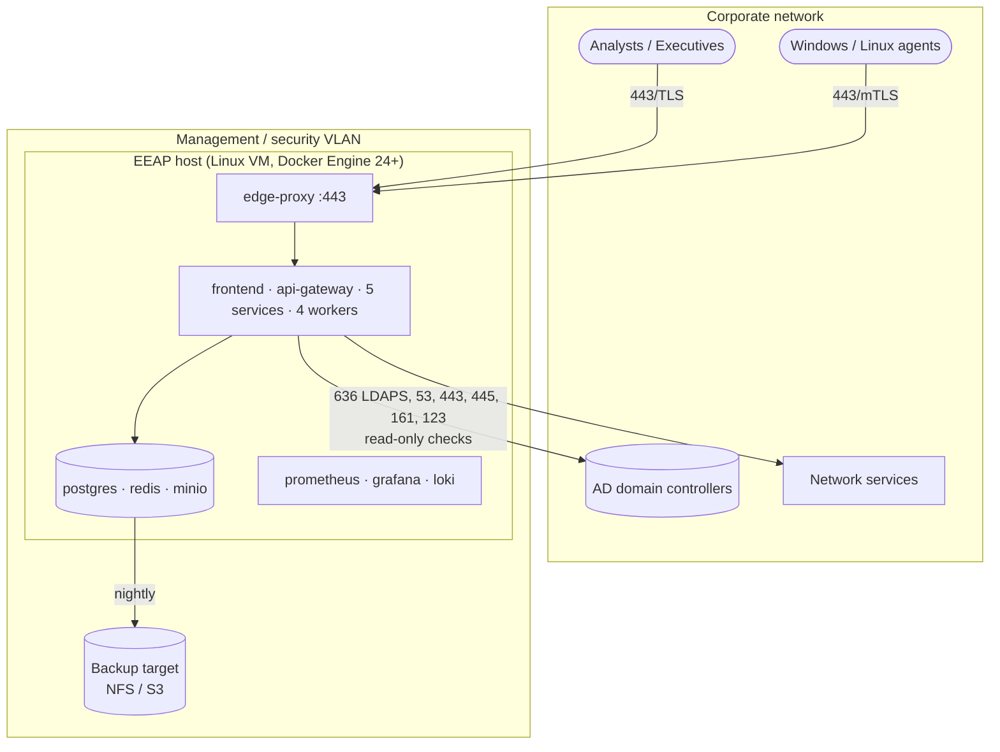
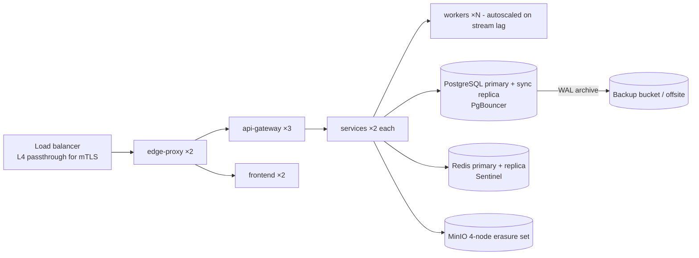

# 09 — Deployment Model

## 1. Deployment tiers

| Tier | Target | Topology | Use |
|------|--------|----------|-----|
| **T1 — Single node** | Docker Compose on one Linux VM (8 vCPU, 32 GB RAM, 500 GB SSD) | All containers on one host | PoC, small enterprises (≤ 5k assets, ≤ 1k agents) |
| **T2 — Resilient Compose / Swarm** | 3-node Docker Swarm + managed/external PostgreSQL + distributed MinIO | Stateless services replicated ×2–3 | Mid-size (≤ 20k assets) |
| **T3 — Kubernetes** | Helm chart (Phase 3) | HPA for workers, PostgreSQL operator (CloudNativePG), Redis Sentinel, MinIO operator | Large enterprises, multi-site |

The same images and environment-variable contract are used in all tiers.

## 2. T1 reference topology



Firewall requirements:

| Direction | Port | Purpose |
|-----------|------|---------|
| Users → EEAP | 443/tcp | UI and API |
| Agents → EEAP | 443/tcp | Agent channel (outbound from endpoints only) |
| EEAP → DCs | 636/tcp (LDAPS), 3269/tcp (GC over TLS) | AD read-only collection |
| EEAP → targets | 53, 443, 445, 161/udp, 123/udp (per enabled NET controls) | Network posture checks |
| EEAP → LLM provider | 443/tcp (optional) | Only if `AI_LLM_PROVIDER` is an external provider |
| Admin → EEAP | 22/tcp (bastion only) | Host administration |

No inbound connections from EEAP to agents are ever required.

## 3. T2/T3 high availability



| Component | HA approach | RPO / RTO |
|-----------|-------------|-----------|
| Stateless services | ≥ 2 replicas, readiness-gated | 0 / < 1 min |
| Workers | Consumer groups; pending-message reclaim | 0 / < 1 min |
| PostgreSQL | Streaming replication, automated failover (Patroni / CloudNativePG), PITR via WAL archive | ≤ 15 min / ≤ 15 min |
| Redis | Sentinel; AOF everysec. Streams are rebuildable from outbox (unpublished rows) | ≤ 1 s / < 1 min |
| MinIO | Erasure coding, versioning, site replication | 0 / < 5 min |

## 4. Environments and promotion

| Environment | Purpose | Data |
|-------------|---------|------|
| `dev` | Developer Compose (`docker compose --profile app up`) with sample data | Synthetic |
| `test` / CI | Ephemeral Compose stack for integration tests | Synthetic |
| `staging` | Production-like; lab AD domain | Lab |
| `prod` | Customer environment | Real |

Promotion is image-digest based: the same signed image digest moves through environments;
only `.env` / secrets differ.

## 5. Configuration contract

| Variable | Example | Applies to |
|----------|---------|-----------|
| `EEAP_ENV` | `prod` | all |
| `EEAP_ROLE` | `api` / `worker` / `migrate` | Python services |
| `LOG_LEVEL` | `INFO` | all |
| `DATABASE_URL` | `postgresql+asyncpg://eeap_asset@postgres:5432/eeap` | services |
| `DATABASE_PASSWORD_FILE` | `/run/secrets/db_password_asset` | services |
| `REDIS_URL` / `REDIS_PASSWORD_FILE` | `redis://redis:6379/0` | all backend |
| `MINIO_ENDPOINT` / `MINIO_ACCESS_KEY_FILE` / `MINIO_SECRET_KEY_FILE` | `http://minio:9000` | assessment, ai, reporting |
| `*_SERVICE_URL` | `http://asset-service:8000` | gateway, consumers |
| `JWT_PUBLIC_KEY_FILE`, `INTERNAL_TOKEN_KEY_FILE` | `/run/secrets/...` | all backend |
| `AI_LLM_PROVIDER` | `none` / `azure_openai` / `openai` / `ollama` | ai-engine |
| `RATE_LIMIT_*` | see `.env.example` | gateway |

Full list: [`.env.example`](../../.env.example).

## 6. Installation (T1)

```bash
# 1. Host prerequisites: Linux x86_64, Docker Engine 24+, Compose v2.20+
# 2. Obtain release bundle and verify signature
cd eeap
./scripts/generate-secrets.sh            # or place production secrets in ./secrets
cp .env.example .env && vi .env          # set EEAP_PUBLIC_HOSTNAME, TLS, scan networks
docker compose --profile app up -d       # Phase 2+: full platform
docker compose ps                        # all healthy
docker compose run --rm api-gateway python -m app.cli create-admin   # Phase 2
```

Upgrades: `docker compose pull && docker compose --profile app up -d` — migration
containers run first (`service_completed_successfully` gate). Rollback: previous image
tags + database restore point taken automatically by the `pre-upgrade` backup job.

## 7. Backup and restore

| Asset | Method | Frequency | Retention |
|-------|--------|-----------|-----------|
| PostgreSQL | `pg_dump -Fc` (T1) / WAL + base backup (T2/T3) | Nightly / continuous | 30 days |
| MinIO evidence/reports | Bucket versioning + replication / `mc mirror` | Continuous / nightly | Per lifecycle policy |
| Secrets | Enterprise secret store | On change | Per policy |
| Configuration | `.env`, compose overrides in Git (no secrets) | On change | – |

Restore is tested quarterly in staging (runbook in Phase 2).

## 8. Operations

- Monitoring: Grafana dashboards — platform health, event lag per consumer group, agent
  fleet status, assessment throughput, API latency/error budgets.
- Alerts: service unhealthy > 2 min, stream lag > 10k messages, DLQ non-empty, agent
  stale ratio > 10 %, certificate expiry < 14 days (edge TLS and Agent CA), audit chain
  verification failure, disk > 80 %.
- Log retention: 30 days in Loki (T1), forwarded to enterprise SIEM in T2/T3.
