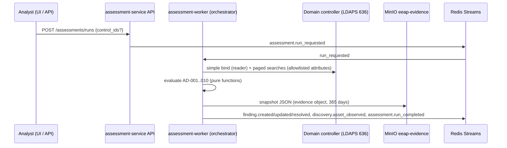

# 11 — Active Directory configuration assessment (AD-001 … AD-010)

The AD module evaluates domain configuration read over **LDAPS** with a dedicated,
unprivileged reader account. It is a configuration review: no Kerberos tickets are requested,
no password or LAPS password attribute is read, no discovered account is ever used to
authenticate, and nothing is written to the directory ([ADR-0011](../adr/0011-defensive-scope-guardrails.md)).

## Flow



* Code: `services/assessment-service/app/collectors/ad_ldap.py` (I/O),
  `app/controls/ad.py` (evaluators), `app/orchestrator.py` (run handling).
* A run is **full scope** for the domain: open findings of the evaluated controls that the run
  no longer observes are resolved (`PASS`, "no longer observed").
* Findings about the domain or accounts attach to the domain asset (`LAB.EEAP.LOCAL`,
  type `Identity`); findings about computers attach to the computer asset (NetBIOS name).
  `subject_key` is the object DN, group SID, or a fixed key for domain-level checks.
* `discovery.asset_observed` creates or refreshes the domain and every enabled computer in the
  inventory; classification rules then set tier/criticality (DCs and the domain → Tier 0)
  unless the asset's classification is locked.

## Configuration

| Variable | Meaning |
|---|---|
| `AD_LDAP_URL` | `ldaps://dc.example.com:636` — plaintext `ldap://` is refused |
| `AD_BASE_DN` | Optional; defaults to the rootDSE `defaultNamingContext` |
| `AD_BIND_USER` | Reader account UPN, e.g. `svc-eeap-reader@example.com` (Domain Users rights suffice) |
| `secrets/ad_bind_password` | Reader password (Docker secret, mounted only into `assessment-worker`) |
| `AD_TLS_CA_FILE` | CA bundle used to verify the DC certificate (hostname verification is always on) |

Only `assessment-worker` receives these settings and the secret.

## Attributes read (ADR-0011 rule 7)

The collector requests exactly these attributes; `check_attributes()` rejects anything else, and
a deny-list (`unicodePwd`, `userPassword`, `ntPwdHistory`, `lmPwdHistory`, `dBCSPwd`,
`supplementalCredentials`, `ms-Mcs-AdmPwd`, `msLAPS-Password`, `msLAPS-Encrypted*`,
`msDS-ManagedPassword`, `msFVE-RecoveryPassword`, `msDS-KeyCredentialLink`, trust secrets, `*`,
`+`) is enforced on top. Unit tests assert both lists.

| Object / search | Attributes |
|---|---|
| rootDSE | `defaultNamingContext`, `schemaNamingContext`, `dnsHostName` |
| Domain head (base) | `distinguishedName`, `objectSid`, `minPwdLength`, `pwdHistoryLength`, `pwdProperties`, `maxPwdAge`, `minPwdAge`, `lockoutThreshold`, `lockoutDuration`, `msDS-Behavior-Version` |
| Users `(&(objectClass=user)(!(objectClass=computer)))` | `distinguishedName`, `sAMAccountName`, `objectSid`, `userAccountControl`, `servicePrincipalName`, `pwdLastSet`, `adminCount`, `msDS-SupportedEncryptionTypes`, `msDS-AllowedToDelegateTo`, `msDS-AllowedToActOnBehalfOfOtherIdentity` (presence only), `lastLogonTimestamp`, `primaryGroupID` |
| Computers `(objectClass=computer)` | user attributes + `dNSHostName`, `operatingSystem`, `operatingSystemVersion`, `ms-Mcs-AdmPwdExpirationTime` and `msLAPS-PasswordExpirationTime` (presence only — never the password) |
| Privileged groups by SID | `distinguishedName`, `sAMAccountName`, `objectSid` |
| Recursive members `(memberOf:1.2.840.113556.1.4.1941:=<group>)` | `distinguishedName`, `sAMAccountName`, `objectSid`, `objectClass`, `userAccountControl` |
| Schema (one level) | `lDAPDisplayName` of the two LAPS expiration attributes |

Privileged groups: Domain Admins (RID 512), Schema Admins (518), Enterprise Admins (519),
Administrators (S-1-5-32-544), Account/Server/Print/Backup Operators (S-1-5-32-548…551).

## Control logic

| Control | Reports | FAIL | WARNING / INFO |
|---|---|---|---|
| AD-001 Password policy | one finding per domain | min length < 8, complexity off with length < 14, reversible encryption, lockout disabled | length < 14, history < 24, lockout threshold > 10; PASS otherwise |
| AD-002 Service accounts | enabled user accounts with SPNs (not krbtgt) | privileged-group member (Critical), password older than 365 days, DES-only | never-expiring password, no AES, DES enabled, adminCount=1 |
| AD-003 Pre-authentication | accounts with `DONT_REQ_PREAUTH` | enabled account (Critical if privileged) | disabled account (Low) |
| AD-004 Unconstrained delegation | non-DC accounts with `TRUSTED_FOR_DELEGATION` | enabled | disabled (Low) |
| AD-005 Constrained delegation | enabled accounts with `msDS-AllowedToDelegateTo` | protocol transition or a DC service target (Critical if both) | other constrained delegation (Low) |
| AD-006 RBCD | enabled objects with `msDS-AllowedToActOnBehalfOfOtherIdentity` | DC or privileged object | other objects |
| AD-007 Privileged groups | one finding per group with issues | Domain Admins > 5 enabled members, SPN accounts as members | Schema/Enterprise Admins non-empty, operator groups in use, disabled members |
| AD-008 LAPS | domain (schema missing) or each enabled non-DC computer | no LAPS schema; computer without LAPS expiration attribute | — |
| AD-009 Legacy OS | enabled computers | past end of extended support | support ends within 180 days |
| AD-010 Tier-0 discovery | domain, DCs, enabled privileged accounts/computers | — | INFO (Informational) |

## Test lab (development only)

`docker-compose.lab.yml` adds a Samba AD DC (`dc1.lab.eeap.local`, realm `LAB.EEAP.LOCAL`) on
the `eeap-scan` network, seeded with configuration weaknesses for every control except AD-006
(see `infrastructure/lab/samba-dc/seed.sh`). The lab CA is shared with the worker through the
`lab_tls` volume.

```bash
./scripts/lab-setup.sh
docker compose -f docker-compose.yml -f docker-compose.lab.yml --profile app up -d --build
```

Never deploy the lab file or image outside a development environment.
