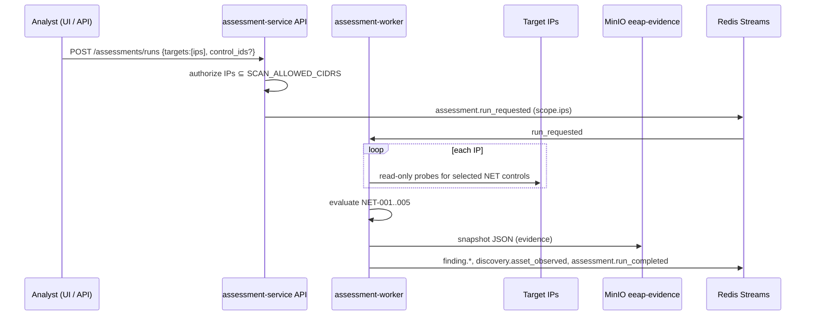

# 12 — Network IP assessment (NET-001 … NET-005)

The NET module probes **explicit IP addresses** from the assessment worker over the
`eeap-scan` network. Checks are read-only protocol observations (TCP/TLS handshake, DNS
AXFR policy, SMB port reachability, SNMP default community, NTP client query). No exploit
payloads, credential brute force or lateral movement ([ADR-0011](../adr/0011-defensive-scope-guardrails.md)).

## Flow



* Code: `services/assessment-service/app/collectors/net_probes.py`,
  `app/controls/net.py`, `app/targets.py`, `app/orchestrator.py`.
* `full_scope=false`: only findings for the scanned IPs are auto-resolved when no longer observed.
* Each IP becomes/refreshes an inventory asset (`IP-<dotted>` / `IP6-…`) with identifier `id_type=ip`.

## Authorization

| Variable | Meaning |
|---|---|
| `SCAN_ALLOWED_CIDRS` | Comma-separated CIDRs the platform may probe. **Required** for NET runs. |

Loopback, link-local, multicast and unspecified addresses are always rejected. Hostnames and
CIDR literals are not accepted in `targets` (pass individual IPs).

## Controls

| Control | Probe | FAIL / WARNING |
|---|---|---|
| NET-001 DNS AXFR | AXFR of `.` against the IP as name server | AXFR permitted |
| NET-002 TLS | TLS handshake on 443 / 8443 | TLS 1.0 or 1.1 accepted |
| NET-003 SMB | TCP connect to 445 | Port open |
| NET-004 SNMP | SNMPv2c GET sysDescr with community `public` | Default community accepted |
| NET-005 NTP | NTP client mode query to UDP/123 | Service responds (WARNING) |

## API / UI

```bash
curl -sk -X POST https://localhost/api/v1/assessments/runs -H "Authorization: Bearer $TOKEN" \
  -H 'Content-Type: application/json' \
  -d '{"targets":["10.0.0.10","10.0.0.20"]}'
# optional: {"targets":["10.0.0.10"],"control_ids":["NET-002","NET-003"]}
```

Dashboard: **Scan IPs** with a multi-line / comma-separated IP list. AD runs remain a separate button
(no `targets`).
