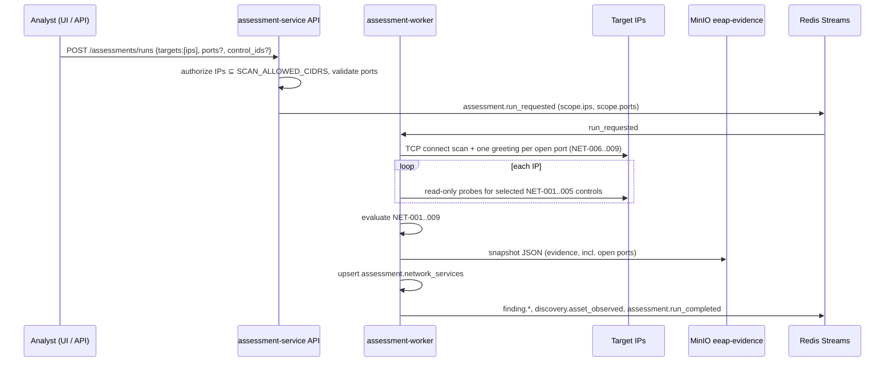

# 12 — Network IP assessment (NET-001 … NET-009)

The NET module probes **explicit IP addresses** from the assessment worker over the
`eeap-scan` network. Checks are read-only protocol observations (TCP/TLS handshake, DNS
AXFR policy, SMB port reachability, SNMP default community, NTP client query, TCP port
discovery with service identification). No exploit payloads, credential brute force or
lateral movement ([ADR-0011](../adr/0011-defensive-scope-guardrails.md)).

## Flow



* Code: `services/assessment-service/app/collectors/net_probes.py`,
  `app/collectors/port_scan.py`, `app/controls/net.py`, `app/targets.py`, `app/orchestrator.py`.
* `full_scope=false`: only findings for the scanned IPs are auto-resolved when no longer observed.
* Each IP becomes/refreshes an inventory asset (`IP-<dotted>` / `IP6-…`) with identifier `id_type=ip`.

## Authorization

| Variable | Meaning |
|---|---|
| `SCAN_ALLOWED_CIDRS` | Comma-separated CIDRs the platform may probe. **Required** for NET runs. |

Loopback, link-local, multicast and unspecified addresses are always rejected. Hostnames and
CIDR literals are not accepted in `targets` (pass individual IPs).

## Controls

| Control | Probe | FAIL / WARNING |
|---|---|---|
| NET-001 DNS AXFR | AXFR of `.` against the IP as name server | AXFR permitted |
| NET-002 TLS | TLS handshake on 443 / 8443 | TLS 1.0 or 1.1 accepted |
| NET-003 SMB | TCP connect to 445 | Port open |
| NET-004 SNMP | SNMPv2c GET sysDescr with community `public` | Default community accepted |
| NET-005 NTP | NTP client mode query to UDP/123 | Service responds (WARNING) |
| NET-006 Remote administration | Port scan: SSH 22, RDP 3389, WinRM 5985/5986, VNC 5900 | Reachable (WARNING) |
| NET-007 Cleartext protocols | Port scan: FTP 21, Telnet 23, rexec/rlogin/rsh 512–514 | Reachable (FAIL) |
| NET-008 Data stores | Port scan: MSSQL, Oracle, MySQL, PostgreSQL, CouchDB, Redis, Elasticsearch, Memcached, MongoDB | Reachable (WARNING) |
| NET-009 Control planes | Port scan: Docker 2375/2376, etcd 2379, Kubernetes API 6443, kubelet 10250 | Docker API or etcd without TLS (FAIL High); otherwise WARNING |

### Windows settings observable on the network (no credentials)

Network runs also evaluate the WIN controls whose configuration is visible on the wire
(`execution_site = server`, migration `assessment_0005`). Hosts that do not expose the service get
no observation (not applicable). The remaining WIN controls (WIN-003, 004, 005, 007, 009) need host
access and stay import/agent only.

| Control | Probe | FAIL / PASS |
|---|---|---|
| WIN-001 SMB signing | SMB2 NEGOTIATE (`collectors/smb_negotiate.py`), security mode | Signing not required (FAIL High) / required |
| WIN-002 SMBv1 | SMB1 NEGOTIATE offering only `NT LM 0.12` | Dialect accepted (FAIL High) / rejected |
| WIN-006 RDP NLA | Port scan RDP negotiation | NLA not required (FAIL) / required |
| WIN-008 WinRM | Port scan | HTTP listener 5985 reachable (FAIL) / HTTPS 5986 only |

Only NEGOTIATE messages are sent: no session setup, authentication, share enumeration or null
sessions. NET-006 reports remote administration *reachability* only; NLA is evaluated by WIN-006.

Port-scan findings use the stable subject `tcp:<port>`; a host without any matching port gets a
single PASS (`remote-admin`, `cleartext`, `data-stores`, `control-planes`).

## Port discovery and service identification

`collectors/port_scan.py` performs **full TCP connects** (no raw packets, no capabilities) against
a curated profile of ~60 enterprise ports (`COMMON_PORTS`) plus optional extra ports from the run
request. Every open port receives at most **one standard protocol greeting**:

| Port type | Greeting | Extracted |
|---|---|---|
| Banner services (SSH, FTP, SMTP, POP3, IMAP, VNC, MySQL, Telnet) | none, read server greeting | product, version, printable banner |
| HTTP ports | `HEAD /` | status, `Server` header, product (Docker, Elasticsearch, WinRM, MinIO, CouchDB) |
| HTTPS / TLS-only ports | TLS handshake (certificate not trusted) | TLS version, certificate CN, issuer, self-signed, expiry |
| RDP 3389 | X.224 connection request offering TLS only | `nla_required` from the negotiation response |
| etcd 2379 | TLS, falling back to plain HTTP | whether TLS is enforced |

No logins, credentials, commands to data stores or exploit payloads are sent.

Limits: at most 1024 extra ports per run (64 entries such as `9000-9010`), hosts × ports ≤ 60 000,
`NET_PORT_SCAN_CONCURRENCY` (default 100) simultaneous connections and
`NET_PORT_CONNECT_TIMEOUT_SECONDS` (default 1 s) per connect; identification uses
`NET_PROBE_TIMEOUT_SECONDS`.

### Service inventory

Open ports are stored in `assessment.network_services` (unique per IP, transport and port) with
service, product, version, TLS version and details. Ports that were open earlier but are closed in
a later scan of the same IP are marked `closed` with `closed_at`. Run statistics include
`ports_scanned`, `open_ports` and `closed_ports`.

`GET /api/v1/network-services?ip=&asset_id=&port=&state=open|closed` (`assets:read`).

NET-006 … NET-009 are mapped to ATT&CK techniques (T1021.*, T1133, T1040, T1213, T1190, T1609,
T1610) with remediation templates in the AI engine (`ai_0006`), so they flow into the risk
scores, roadmap and reports.

### Lab targets

`docker-compose.lab.yml` adds deliberately exposed targets on `eeap-scan` (no account can log in):

| Service | Exposes | Expected result |
|---|---|---|
| `lab-legacy` | SSH 22, FTP 21, Telnet 23, Samba 445 (SMBv1, signing off) | NET-006 WARNING, NET-007 FAIL (Telnet High), WIN-001 / WIN-002 FAIL |
| `lab-redis` | Redis 6379 without authentication | NET-008 WARNING |
| `lab-etcd` | etcd 2379 over plain HTTP | NET-009 FAIL High |

Find their addresses with `docker network inspect eeap_eeap-scan` and set `SCAN_ALLOWED_CIDRS`
to that subnet.

## API / UI

```bash
curl -sk -X POST https://localhost/api/v1/assessments/runs -H "Authorization: Bearer $TOKEN" \
  -H 'Content-Type: application/json' \
  -d '{"targets":["10.0.0.10","10.0.0.20"]}'
# optional: {"targets":["10.0.0.10"],"control_ids":["NET-002","NET-003"]}
# extra ports: {"targets":["10.0.0.10"],"ports":["8081","9000-9010"]}
```

Dashboard: **Scan IPs** with a multi-line / comma-separated IP list and optional extra TCP ports;
the **Network services** table lists open ports with the identified service. AD runs remain a
separate button (no `targets`).
