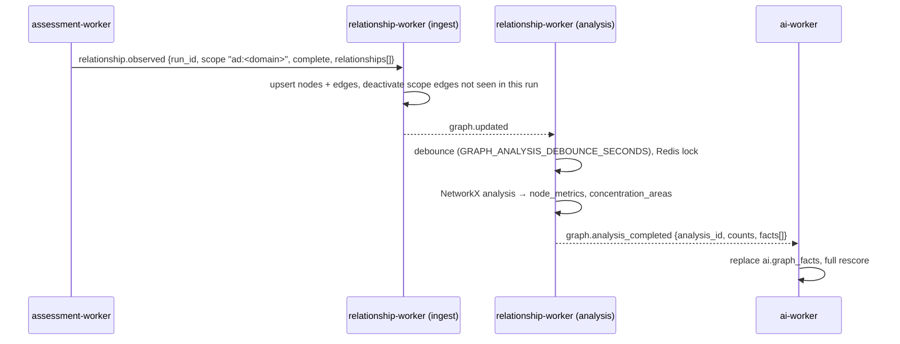

# 13 — Exposure Graph Analytics

The Relationship Engine keeps the exposure graph (`graph.nodes`, `graph.edges`), analyses it with
NetworkX (ADR-0004) and publishes per-object graph context that the AI Engine uses for the
propagation factor **R** and the privilege factor **P** of the risk model (doc 08).

## Data flow

## Relationships collected from AD

Every AD assessment run emits one `relationship.observed` event built from the same read-only
LDAP snapshot that the AD controls evaluate (no extra queries). Edge direction is the direction
compromise travels: whoever controls the source gains what the target grants.

| Edge | Source → target | Meaning |
|------|-----------------|---------|
| `MemberOf` | account / computer / nested group → privileged group | (transitive) membership of Domain Admins, Enterprise Admins, Account Operators, … |
| `PrivilegedAccess` | privileged group → domain | the group administers the domain |
| `Delegation` (constrained) | account → computer behind the `msDS-AllowedToDelegateTo` SPN | `protocol_transition` marks S4U2Self ("any authentication protocol") |
| `Delegation` (unconstrained) | non-DC account/computer → domain | TGTs of connecting users are cached on the host |

Node keys: computers use `asset:<asset_id>` (merging with inventory nodes), the domain is the
`Tier0Asset` `asset:<domain asset id>`, other principals use `ad:<SID>`. Privileged groups, domain
controllers and the domain are Tier 0; members of privileged groups are marked privileged.
Disabled accounts are kept in the graph but are never a stepping stone.

Tier-0 flags from the inventory (`tier = Tier0`) and from collectors are tracked separately on the
node (`inventory_tier0`, `collector_tier0`), so either source can withdraw its claim.

Edges carry `scope = "ad:<domain>"`. A complete run deactivates the scope's collector edges that it
did not observe (`is_active = false`), so removed memberships and delegations drop out of the analysis.

## Analysis

Bounded reverse BFS from all Tier-0 nodes (`GRAPH_MAX_PATH_DEPTH`, default 6) gives, per node:

- `min_hops_to_tier0` and `paths_to_tier0` (number of shortest paths, capped at 10,000);
- `propagation_score` = 1.0 on Tier 0, else `min(1, 1 − 0.1·hops + 0.05·log2(paths))`
  (Tier 0 two hops away over one path = **0.8**, the doc 08 example), 0 when unreachable;
- `inbound_privileged_degree` and a log-scaled `concentration_score`.

Concentration areas (top 25 per type, scores 0–1, log-scaled):

| Area | Rule |
|------|------|
| `privileged_group_sprawl` | privileged group with more than 5 enabled members |
| `delegation_cluster` | Tier-0 delegation target, or ≥ 3 accounts delegating to one host |
| `admin_access_hub` | principal with administrative access to ≥ 5 systems |
| `service_account_hub` | service account with ≥ 3 privileged outbound relationships |
| `tier0_exposure` | per Tier-0 object: number of non-Tier-0 objects with a path to it |

Only non-trivial metric rows are stored; the last 5 analysis runs are kept.

Graph changes are debounced: a run starts once the graph has been quiet for
`GRAPH_ANALYSIS_DEBOUNCE_SECONDS` (default 60) or at the latest after 5× that delay. A Redis
lock keeps replicas from analysing concurrently; one analysis runs at worker start-up.

## Risk scoring

`graph.analysis_completed` carries facts keyed the way findings reference subjects: the asset id
and, for directory objects, the lower-cased DN. The AI Engine replaces `ai.graph_facts` and
rescores all findings:

- a finding whose `subject_key` is a DN uses that object's fact, other findings use their asset's;
- **R** = the fact's `propagation_score` (0 when the subject has no path once an analysis exists;
  `propagation_source = not_available` before the first analysis);
- **P** is raised to 1.0 when the graph marks the subject Tier 0 or privileged.

## API (`graph:read`)

| Endpoint | Purpose |
|----------|---------|
| `GET /graph/nodes` | nodes with latest metrics (`node_type`, `is_tier0`, `q` filters) |
| `GET /graph/nodes/{id}/neighborhood` | subgraph to depth 3, capped at `GRAPH_MAX_RESPONSE_NODES` |
| `GET /graph/exposure-paths` | shortest chains to Tier 0 following the latest analysis' hop distances |
| `GET /graph/concentration-areas` | areas of the latest analysis |
| `GET /graph/analysis/latest` | latest analysis with exposure counts |
| `GET /graph/relationships` | flat `{source, relationship, target}` export |

The dashboard shows the latest analysis and its top concentration areas.

## Limits and next steps

- Only AD privileged-group membership and delegation are collected today. Local administrator
  rights, sessions and ACL-based control (AdministrativeAccess, RemoteAccess) need Windows/ACL
  collectors and will appear as further `relationship.observed` sources.
- Resource-based constrained delegation is reported by AD-005 but not yet modelled as an edge
  (it requires reading the security descriptor of `msDS-AllowedToActOnBehalfOfOtherIdentity`).
- Correlation rules (risk scenarios) build on these facts next.
