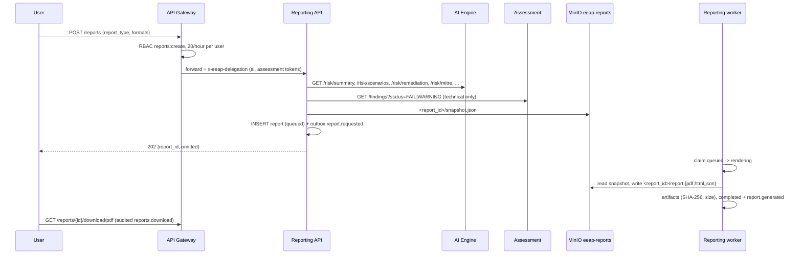

# 16 — Reporting

The Reporting Service turns the current risk picture into executive and technical reports in
PDF, HTML and JSON. Data is collected with the requester's permissions
([ADR-0016](../adr/0016-delegated-report-reads.md)); rendering is asynchronous.

## Flow

## Report types

| Type | Sections | Data |
|------|----------|------|
| `executive_summary` | overview, priority actions (top 10), risk scenarios, ATT&CK tactics, most exposed assets | summary, scenarios, remediation, mitre, top assets |
| `technical` | overview, open findings with score and recommendation (landscape), scenarios, roadmap | + open findings (`findings:read`), top findings |
| `remediation_roadmap` | overview, roadmap grouped by phase | summary, remediation, scenarios |
| `mitre_mapping` | overview, techniques, tactics, roadmap with technique references | summary, mitre, remediation |

`security_posture` and `risk_dashboard` remain catalogued templates without a renderer.
Missing permissions omit a section; the report states which ones. Raw evidence is never included.

## Rendering

- HTML from one Jinja2 template with autoescaping; PDF with WeasyPrint (A4, page numbers);
  JSON = report metadata + snapshot. External resources are blocked during PDF rendering.
- The worker claims a report by moving it from `queued` to `rendering`, so redelivered events
  are ignored. Failures set `failed` with the error and emit `report.failed`.
- Artifacts: `eeap-reports/<report_id>/report.<fmt>`, SHA-256 and size in
  `reporting.report_artifacts`; `expires_at` = snapshot + 180 days (bucket lifecycle).

## Download

Downloads stream through the gateway (no pre-signed URLs; MinIO stays internal), are audited as
`reports.download`, and are always sent as attachments with `ETag` = SHA-256 so rendered HTML is
never displayed on the application's origin.

## Configuration

`REPORT_MAX_FINDINGS` (1000), `UPSTREAM_TIMEOUT_SECONDS` (20), `REPORT_RETENTION_DAYS` (180),
`REPORT_ORGANIZATION` (title line).

## Next steps

- Scheduled reports (needs a credential decision, see ADR-0016).
- Optional LLM narrative section, labelled advisory (ADR-0010).
