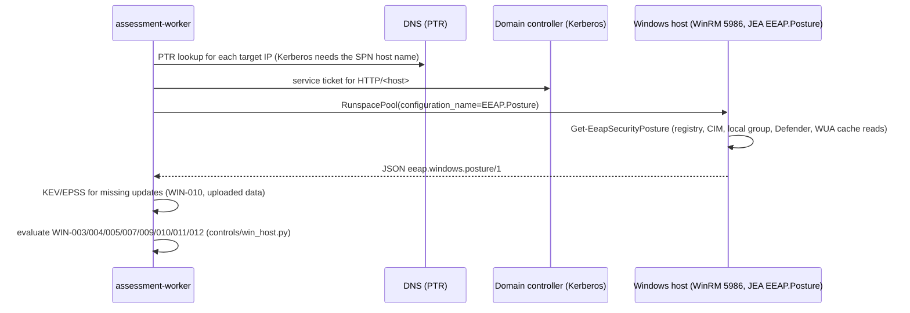

# 17 — Credentialed Windows posture over WinRM (WIN-003, 004, 005, 007, 009 … 012)

Network runs ([doc 12](12-net-assessment.md)) can also read host settings from Windows targets
over WinRM. The scanner never gets a shell: each target registers a **JEA endpoint**
(`EEAP.Posture`) that allows exactly one read-only command, `Get-EeapSecurityPosture`
([ADR-0017](../adr/0017-winrm-jea-posture-collection.md), [ADR-0011](../adr/0011-defensive-scope-guardrails.md)).

## Flow



* Code: `app/collectors/winrm_posture.py` (I/O, pypsrp), `app/controls/win_host.py`
  (pure evaluators), `infrastructure/windows/jea/` (endpoint and posture function).
* Collection runs only when the run selects at least one WinRM control and the worker has both
  `WINRM_USERNAME` and the password secret. Hosts are collected in parallel (`WINRM_CONCURRENCY`).
* The posture document of every host (or the failure stage: `dns`, `connect`, `auth`,
  `endpoint`, `wsman`, `transport`, `parse`) is stored in the run evidence under
  `probes.windows`. Run stats show `winrm_assessed` and `winrm_failed`.
* If collection fails on a host, its open WinRM findings stay open; only hosts that returned a
  posture document can resolve them.
* Successful hosts enrich the asset (host name, FQDN, OS, domain, type
  `DomainController` / `Server` / `Workstation`) and get the tag `winrm:assessed`.

## Controls

| Control | Posture field | Result |
|---|---|---|
| WIN-003 NTLM hardening | `LmCompatibilityLevel` (unset = 3), `NoLMHash` | ≤ 2 or LM hashes stored: FAIL High; 3–4: WARNING Medium; 5: PASS |
| WIN-004 LDAP signing (DC only) | `NTDS\Parameters\LDAPServerIntegrity` | ≥ 2: PASS; otherwise FAIL High |
| WIN-005 LDAP channel binding (DC only) | `NTDS\Parameters\LdapEnforceChannelBinding` | 2: PASS; 1: WARNING Medium; 0 / unset: FAIL Medium |
| WIN-007 Local Administrators (not on DCs) | Members of `S-1-5-32-544` | Members other than RID 500, Domain Admins (RID 512) or `WIN_LOCAL_ADMINS_ALLOWED`: WARNING Medium; else PASS |
| WIN-009 Endpoint protection | `Get-MpComputerStatus`, known EDR services | No Defender real-time protection and no running EDR: FAIL High; Defender only with signatures older than 7 days: WARNING Medium; else PASS |

| WIN-010 Missing security updates | Offline WUA search of the host's cached scan (`updates.pending`), CISA KEV / EPSS uploads | One FAIL per missing security update, severity from MSRC (Critical; Important → High; Moderate → Medium; Low; unrated → Medium), at least High if a fixed CVE is KEV-listed; none: PASS. Last WUA search > 30 days ago or never: WARNING Low (`wu-scan`) |
| WIN-011 Patch currency | Newest `Win32_QuickFixEngineering` date / WUA last installation, reboot-pending keys | No update for > 60 days: FAIL High; > 35 days or reboot pending: WARNING Medium; no date: WARNING Low; else PASS |
| WIN-012 OS lifecycle | Build, `EditionID`, `InstallationType` | End of security updates passed: FAIL High; within 180 days: WARNING Medium; else PASS. Unknown builds are skipped |

Subjects are fixed per host (`ntlm`, `ldap-signing`, `ldap-channel-binding`,
`local-administrators`, `endpoint-protection`, `updates`, `wu-scan`, `patch-currency`,
`os-lifecycle`), except WIN-010 failures, which use `kb:<KB>` (or `update:<hash of title>` without
a KB), so each missing update is its own finding and resolves when it is installed.

### Patch status (WIN-010 … WIN-012)

Decision: [ADR-0021](../adr/0021-windows-patch-status-from-wua-cache.md). The posture function
reads the Windows Update Agent's **cached** results (`IUpdateSearcher.Online = false`), so the
scan never downloads, installs or contacts Windows Update / WSUS; the list is as current as the
host's own last scan, which `wu-scan` reports. Definition (antivirus signature) and driver updates
are ignored. Missing updates carry `cves`, `msrc_severity`, `categories`, `released` and, when KEV
or EPSS data was uploaded on the Vulnerability data page, `known_exploited`, `epss` and an
`exploitability` that overrides the control default in risk scoring
([ADR-0020](../adr/0020-exploitation-and-exposure-in-risk-scoring.md)).

WIN-012 uses end-of-security-update dates per build and servicing class (Extended Security
Updates are not considered):

| Build | Release | End of security updates |
|---|---|---|
| 7601 | Windows 7 / Server 2008 R2 | 2020-01-14 |
| 9200 / 9600 | Server 2012 / 2012 R2 | 2023-10-10 (Windows 8.1: 2023-01-10) |
| 14393 | Server 2016 / Windows 10 LTSB 2016 | 2027-01-12 / 2026-10-13 |
| 17763 | Server 2019 / Windows 10 LTSC 2019 | 2029-01-09 |
| 19044 | Windows 10 21H2 LTSC 2021 / IoT LTSC 2021 | 2027-01-12 / 2032-01-13 |
| 19045 | Windows 10 22H2 | 2025-10-14 |
| 20348 | Server 2022 | 2031-10-14 |
| 22621 / 22631 | Windows 11 22H2 / 23H2 (Home, Pro) | 2024-10-08 / 2025-11-11 |
| 22621 / 22631 | Windows 11 22H2 / 23H2 (Enterprise, Education) | 2025-10-14 / 2026-11-10 |
| 26100 | Server 2025 | 2034-10-10 |
| 26100 | Windows 11 24H2 (Home, Pro / Enterprise, Education / LTSC 2024) | 2026-10-13 / 2027-10-12 / 2029-10-09 |
| 26200 | Windows 11 25H2 (Home, Pro / Enterprise, Education) | 2027-10-12 / 2028-10-10 |

Older Windows 10 and 11 feature updates are in `CLIENT_LIFECYCLE` as well. Hosts with a posture
module older than 1.1.0 return no `updates` section; WIN-010/011 are then reported as unassessed
and their open findings stay open — rerun `Install-EeapJea.ps1` to update the module.

## Target setup

1. Create a domain group for the scanner (for example `CORP\EEAP-Scanners`) and an ordinary
   domain user in it. The user needs no other rights.
2. Enable a WinRM HTTPS listener (5986) with a certificate the worker trusts.
3. Copy `infrastructure/windows/jea/` to the host and, as administrator:

   ```powershell
   # member servers and workstations: session runs as a temporary virtual account
   .\Install-EeapJea.ps1 -ScannerPrincipal 'CORP\EEAP-Scanners'
   # domain controllers: virtual accounts are not available, use a gMSA
   .\Install-EeapJea.ps1 -ScannerPrincipal 'CORP\EEAP-Scanners' -GroupManagedServiceAccount 'CORP\gmsa-eeap$'
   ```

   Deploy at scale with a GPO startup script or configuration management. Remove with
   `Uninstall-EeapJea.ps1`. Session transcripts are written to `%ProgramData%\EEAP\JeaTranscripts`.
4. Make sure the target IPs have PTR records (Kerberos authenticates the host name, not the IP).

The endpoint runs in `NoLanguage` mode with `RestrictedRemoteServer`; the function is loaded
from a module under Program Files, which the scanner account cannot modify.

## Configuration

| Variable | Default | Meaning |
|---|---|---|
| `WINRM_USERNAME` | — | Scanner account (`user@REALM` or `DOMAIN\user`). Empty disables the WinRM controls. |
| `secrets/winrm_password` | — | Password (Docker secret, mounted on workers only). |
| `WINRM_AUTH` | `kerberos` | `kerberos`, `negotiate` or `ntlm`. Basic and CredSSP are not supported. |
| `WINRM_PORT` / `WINRM_USE_TLS` | `5986` / `true` | With TLS off, message encryption is forced. |
| `WINRM_CA_FILE` | system store | CA bundle for listener certificates. |
| `WINRM_REALM` / `WINRM_KDC` | — | Kerberos realm and optional KDC (otherwise located through DNS SRV). |
| `WINRM_CONFIGURATION_NAME` | `EEAP.Posture` | JEA endpoint name. |
| `WIN_LOCAL_ADMINS_ALLOWED` | — | Comma-separated names (wildcards allowed) or SIDs expected in local Administrators. |

Without `WINRM_USERNAME` the API drops the WinRM controls from the default selection of a NET
run; requesting them explicitly returns 422.

## Testing

There is no Windows host in the lab. `tests/unit/test_win_winrm.py` covers the evaluators with
posture fixtures, the collector with a fake invoke, and the real pypsrp client against a local
listener that rejects authentication (`auth` stage) and a closed port (`connect` stage);
`tests/unit/test_win_patch.py` covers WIN-010 … 012. The posture function was validated on
Windows 11 and Windows PowerShell 5.1, including the update section (offline WUA search as a
standard user, about 5 seconds).
