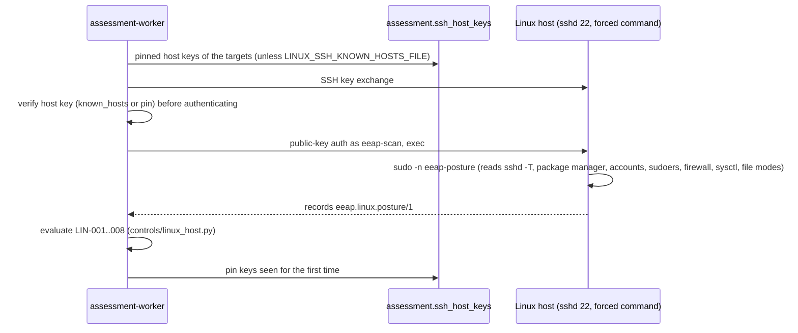

# 18 — Linux host posture over SSH (LIN-001 … LIN-008)

Network runs ([doc 12](12-net-assessment.md)) can read the configuration of Linux hosts over SSH.
The scanner key is accepted only with a **forced command**: whatever the client asks for, sshd runs
`sudo -n /usr/local/libexec/eeap/eeap-posture`, a root-owned, read-only script
([ADR-0018](../adr/0018-ssh-forced-command-posture.md), [ADR-0011](../adr/0011-defensive-scope-guardrails.md)).

## Flow



* Code: `app/collectors/ssh_posture.py` (I/O, paramiko), `app/controls/linux_host.py` (pure
  evaluators), `infrastructure/linux/` (posture script, installer, uninstaller).
* Collection runs when the run selects a LIN control and the worker has `LINUX_SSH_USERNAME` and the key
  secret. If the port scan covered the SSH port, only hosts where it is open are contacted.
* Results (or the failure stage: `connect`, `hostkey`, `auth`, `ssh`, `command`, `parse`, `config`)
  are stored in the run evidence under `probes.linux`. Run stats show `ssh_assessed`, `ssh_failed`,
  `ssh_skipped` and `ssh_host_keys_pinned`.
* Hosts that were skipped or failed keep their open LIN findings; only hosts that returned a complete
  posture can resolve them.
* Successful hosts enrich the asset (host name, FQDN, `os_family` Linux, release) and get the tag
  `ssh:assessed`.

## Controls

| Control | Source | Result |
|---|---|---|
| LIN-001 SSH daemon hardening | `sshd -T` | `PermitRootLogin yes` or `PermitEmptyPasswords yes`: FAIL High; password logins, CBC / arcfour / 3DES ciphers, MD5 / 96-bit MACs, SHA-1 key exchange: WARNING Medium; `MaxAuthTries` > 6: WARNING Low |
| LIN-002 Security updates | apt (simulation), dnf/yum (cache only), apk | Security updates pending: FAIL High; apk updates pending or reboot required: WARNING Medium; metadata older than 30 days: WARNING Low; no package metadata: not evaluated |
| LIN-003 Privileged access | `/etc/passwd`, sudoers, sudo/wheel/admin groups | UID 0 besides root: FAIL High; NOPASSWD rules or members outside `LINUX_ADMINS_ALLOWED`: WARNING Medium |
| LIN-004 Host firewall | nftables input chain, iptables INPUT, ufw, firewalld | Nothing filters inbound traffic: FAIL Medium |
| LIN-005 Local accounts | `/etc/shadow` (only whether the field is empty), `login.defs` | Empty password: FAIL High; `PASS_MAX_DAYS` > 365: WARNING Low |
| LIN-006 Kernel hardening | `/proc/sys` | ASLR not 2, source routing, `fs.protected_*` off: WARNING Medium; redirects, SYN cookies off, `kptr_restrict` / `dmesg_restrict` 0, `suid_dumpable`, `ptrace_scope` 0: WARNING Low |
| LIN-007 Sensitive file permissions | `stat` of passwd, group, shadow, gshadow, sudoers, sshd_config; world-writable files in `/etc` | Shadow readable by others or passwd / sudoers world-writable: FAIL High; other issues: FAIL Medium |
| LIN-008 OS lifecycle | `/etc/os-release` | Past end of free security support: FAIL High; within 180 days: WARNING Medium; unknown release: not evaluated |

LIN-008 knows Alpine, Ubuntu LTS, Debian, RHEL and rebuilds (Rocky, AlmaLinux, Oracle Linux), CentOS
(Linux and Stream) and Amazon Linux; extended paid support (ESM, ELS) is not considered.

## Target setup

1. Generate the scanner key (`scripts/generate-secrets.sh` creates `secrets/linux_ssh_key` and
   `secrets/linux_ssh_key.pub`).
2. On each host, as root, with `sudo` installed:

   ```sh
   ./install-eeap-posture.sh "$(cat linux_ssh_key.pub)" "10.0.5.20"   # optional from= scanner address
   ```

   This installs `/usr/local/libexec/eeap/eeap-posture` (root-owned), the account `eeap-scan` without a
   usable password, a root-owned `authorized_keys` entry with `restrict,command="sudo -n …"` and the
   sudo rule `/etc/sudoers.d/eeap-posture` (that command, no arguments). Remove everything with
   `uninstall-eeap-posture.sh`. Requires OpenSSH 7.2+.
3. Set `LINUX_SSH_USERNAME=eeap-scan` and recreate the assessment containers.

## Host key verification

* Default: **trust on first use**. The first successful run pins the host key
  (`GET /api/v1/ssh-host-keys`). A different key later fails the host with stage `hostkey` and its
  findings stay open. After a verified re-key, remove the pin with
  `DELETE /api/v1/ssh-host-keys/{ip}?port=22` (`assessments:manage`).
* Strict: mount an OpenSSH known_hosts file and set `LINUX_SSH_KNOWN_HOSTS_FILE`. Hosts not listed are
  refused and nothing is pinned.

## Configuration

| Variable | Default | Meaning |
|---|---|---|
| `LINUX_SSH_USERNAME` | — | Scanner account (`eeap-scan`). Empty disables the LIN controls. |
| `secrets/linux_ssh_key` | — | Unencrypted Ed25519 (or ECDSA / RSA) private key, mounted on workers only. |
| `LINUX_SSH_PORT` | `22` | SSH port. |
| `LINUX_SSH_KNOWN_HOSTS_FILE` | — | Strict host key checking instead of pinning. |
| `LINUX_ADMINS_ALLOWED` | — | Expected members of sudo / wheel / admin besides root (wildcards allowed). |

Without `LINUX_SSH_USERNAME` the API drops the LIN controls from the default selection of a NET run;
requesting them explicitly returns 422.

## Lab

`lab-legacy` (Alpine 3.20) installs the posture command at start with `secrets/linux_ssh_key.pub` and
ships deliberate weaknesses: root and password logins with a CBC cipher, `MaxAuthTries 10`, a NOPASSWD
sudo rule for `wheel`, an extra UID 0 account without a shell, a service account with an empty password
and no shell, and a world-writable file in `/etc`. None of them allow a login. Expected result: LIN-001,
003, 004, 005, 007 and 008 FAIL, LIN-006 depends on the Docker host kernel, LIN-002 is not evaluated
(no package index in the image).
